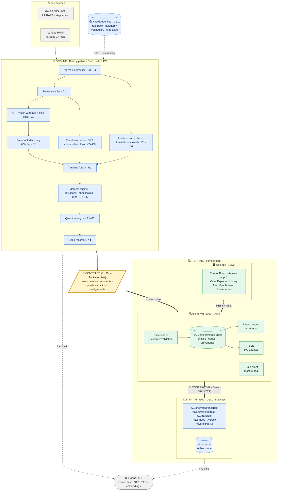

# MVP Master Plan: Surgical Knowledge System (RARP)

> **Organisation:** MY ROBOTS
> **Scope:** the MVP only (not the full product)
> **Date:** 2026-10-16
> **Inputs:** `Surgical_Knowledge_System_Idea.md` (the idea) and `Research_Report_Phase0.md` (the research)
> **Status:** approved by the owner on 2026-10-16. Phase 0 starts Mon 19 Oct 2026. Every decision is logged in `docs/DECISIONS.md`; live progress is in `docs/status/`.

---

## 0. Decisions this plan is built on (made by the project owner)

| Topic | Decision |
|---|---|
| Surgery X | **RARP (robot-assisted radical prostatectomy) only** |
| Video sources | Open datasets (**GraSP / PSI-AVA**) plus **YouTube RARP videos**, for private demo use only |
| Audience | **All four:** investors, surgeons, hospital, internal |
| Surgeon | Available **later**. Until then the dev team role-plays the surgeon, and those answers are labelled "Simulated" |
| Timeline | **6 weeks** (D-006) |
| Team | **Dev1** (office PC x64, home Surface ARM64 16 GB) and **Dev2** (home, ASUS Zenbook Snapdragon ARM64 48 GB; in the office, **office laptop #2**, x64, same model as Dev1's office PC, D-028). Both are generalists and both build with Claude |
| Way of working | **Two parallel tracks with minimal dependency, integrated at the end** |
| Compute | No NVIDIA GPU, so **no model training** |
| Paid AI | **OpenAI only** |
| Vision | **GPT vision only** (sampled frames, not training) |
| Language | **Bilingual Japanese + English**, both UI and content |
| Answer modes | **Tap, voice and text, given equal weight** |
| Knowledge unit | **Extended model** (from the surgical panel) |
| Demo runs on | **Local laptop** |

---

## 1. What the MVP is, in one paragraph

A recorded RARP video plays **as if it were live**. While it plays, the system shows the surgical step, flagged moments (bleeding, a step that runs long, safety checkpoints) and the transcript, in Japanese and English. When the "surgery" ends, a phone screen shows **"4 questions · about 3 minutes"**. Each question comes with its video clip, and the surgeon answers by **tap, voice or text**. The AI reads its understanding back for one-tap confirmation. The answer becomes a **verified decision record**, which appears **live** in the knowledge graph and in the **Knowledge Library**. There the user can browse obstacles across cases, compare how different surgeons handled them, and **ask questions in plain Japanese or English**. Answers come with cited clips, and **every fact shows where it came from**.

---

## 2. Feature catalogue (everything we will deliver)

**Priority key (MoSCoW):**
- **M** = Must. Built first; these would ship even in a 4-week plan.
- **S** = Should. Built once M is done. The **6-week plan was chosen (D-006)**, so M + S ship.
- **C** = Could. Stretch goals, only if time allows.

**Owner:** **Dev1** (the "Brain" track) or **Dev2** (the "App" track).

### 2.1 Knowledge foundation (Dev1)

| ID | Feature | What it delivers | Pri |
|---|---|---|---|
| A1 | **RARP Rule Book** | Phases and steps in order; typical duration ranges; anatomy and instruments per step; safety checkpoints; known obstacles per step; bilingual terms. Stored as one YAML file. Draft until a surgeon reviews it | M |
| A2 | **Core ontology (Layer 0)** | The shared types of things and relations: Case, Step, Moment, Obstacle, Cue, Action, Actor, Reason, Outcome, Evidence, Decision Record. Aligned to OntoSPM and PROV-O through IRIs | M |
| A3 | **Obstacle family tree** | The 8 universal families plus RARP-specific obstacles. Also records what caused each obstacle (patient, event, technical, equipment, unknown) | M |
| A4 | **Bilingual vocabulary** | JA/EN terms with synonyms (e.g. DVC = dorsal vein complex = サントリーニ静脈叢) | M |
| A5 | **Trust labels** | 🤖 AI-detected · 📐 Dataset annotation · 🎙️ Extracted from narration · 🩺 Explained by operating surgeon · 👁️ Interpreted by reviewer · ✅ Expert-validated · 🧪 Simulated (demo). Delivered as `TrustLabel` in `contracts` (Phase 0, D-041) | M |
| A6 | **Visual step atlas** | 2–3 reference frames per step, taken from GraSP's ground-truth labels and shown to GPT as examples (no training) | M |
| A7 | Severity grading | EAUiaiC grade on events | C |

### 2.2 Case ingestion (Dev1)

| ID | Feature | What it delivers | Pri |
|---|---|---|---|
| B1 | **GraSP / PSI-AVA importer** | Videos plus their ground-truth phases and steps, turned into cases | M |
| B2 | **YouTube importer** | yt-dlp download plus metadata: language, whether the video is narrated, and **whether it is edited/condensed** | M |
| B3 | **Normaliser** | 720p H.264 "faststart" MP4, a 16 kHz mono audio track, a poster frame and thumbnail strips | M |
| B4 | **Case registry** | One `case.json` per case: source, type (full-length or edited), language, data note | M |
| B5 | RARPL importer | An extra open dataset (CC BY 4.0) | C |

### 2.3 Perception, with GPT vision only (Dev1)

| ID | Feature | What it delivers | Pri |
|---|---|---|---|
| C1 | **Frame sampler** | One frame every N seconds (default 5), plus extra frames where the scene changes | M |
| C2 | **Step recognition** | GPT looks at 1-minute windows of frames, with the rule book and the step atlas as context, and returns step probabilities | M |
| C3 | **Rule-book decoding** | Turns the noisy per-window guesses into clean, ordered step segments using rule-book order and duration priors (Viterbi). This is plain code, not training, and the **biggest accuracy lever** | M |
| C4 | Instrument tagging | Instruments visible in each window, from the same GPT call | S |
| C5 | **Event detection** | Bleeding (red-pixel ratio plus a GPT check), camera out of body, idle/pause; smoke and suction are S | M |
| C6 | **Deep look** | For each flagged moment, GPT gets denser frames and describes what is visible and what changed | M |
| C7 | **Accuracy evaluator** | Scores GPT's steps against GraSP's ground truth (frame accuracy, segment F1) and writes `metrics.json`. These numbers are reported honestly | M |
| C8 | **Ground-truth mode** | For GraSP cases, uses the dataset's own step labels, shown with the 📐 label | M |
| C9 | True live processing | GPT processes each window while the video plays | C |

### 2.4 Audio and language (Dev1)

| ID | Feature | What it delivers | Pri |
|---|---|---|---|
| D1 | **Audio extraction and chunking** | Chunks small enough for the API's 25 MB file limit | M |
| D2 | **Timestamped transcription** | `whisper-1` (segment timestamps) or `gpt-4o-transcribe-diarize` (timestamped segments with speaker labels) | M |
| D3 | **JA↔EN translation** | Every utterance stored in both languages | M |
| D4 | **Utterance classification** | Instruction / concern / explanation / decision / bookmark / teaching / irrelevant | M |
| D5 | Term normalisation | Maps spoken terms to the vocabulary (A4) | S |
| D6 | Synthetic operating-room speech | Scripted OR-style lines voiced by TTS for GraSP cases, which have no audio. Labelled "synthetic" | S |
| D7 | **Narration mining** | YouTube narration often explains *why*. This turns it into draft decision records labelled 🎙️ | S |

### 2.5 Timeline and moment engine (Dev1)

| ID | Feature | What it delivers | Pri |
|---|---|---|---|
| E1 | **Timeline fusion** | Steps, events, instruments and utterances merged into one `timeline.json` | M |
| E2 | **Deviation detection** | A step longer or shorter than usual (z-score against the rule book; **switched off for edited videos**), plus missing, extra and out-of-order steps | M |
| E3 | **Event and speech moments** | Bleeding, a concern in the transcript, a bookmark, an explanation given at a decision point | M |
| E4 | **Checkpoint decision points** | Moments where nothing went wrong but a decision was made, e.g. "Ureteral orifices identified before bladder neck closure?" | M |
| E5 | **Moment ranking** | Merges duplicates, scores the moments, and picks each clip's start and end | M |
| E6 | **Clip cutter** | Pre-cut MP4 clips and a poster image per moment | M |

### 2.6 Question engine (Dev1)

| ID | Feature | What it delivers | Pri |
|---|---|---|---|
| F1 | **Typed questions** | Cue, decision, reason, alternatives, confirm-what-you-said, checkpoint, options-at-this-point. **There is no "could this have been avoided?" question** | M |
| F2 | **Two styles** | Operating surgeon ("you") and reviewer ("the surgeon") | M |
| F3 | **Tap scaffolding** | Each question carries an AI draft (✓ correct / ✎ edit / ✗ not an issue) and multiple-choice options | M |
| F4 | Knowledge-base-aware | If an obstacle is already well covered in the knowledge base, only ask for confirmation | S |
| F5 | **Uses what was said** | "You said '…'. Is this why?" | M |
| F6 | **Budget** | 3–5 questions in operating mode, up to 10 in reviewer mode, each with a time estimate | M |
| F7 | **Bilingual questions** | JA and EN text for every question | M |

### 2.7 Answer-to-knowledge engine, at runtime (Dev1)

| ID | Feature | What it delivers | Pri |
|---|---|---|---|
| G1 | **Voice transcription endpoint** | Turns spoken answers into text, JA or EN | M |
| G2 | **Extraction into a Decision Record** | The answer becomes a Decision Record (§4) as strict JSON | M |
| G3 | **Read-back** | A short JA/EN summary for one-tap confirmation, with editable chips | M |
| G4 | New-term detection | Flags unknown terms so the vocabulary can grow | S |
| G5 | **No invention** | A field the surgeon did not mention stays empty ("not stated"). Every filled field must point to the words that support it | M |

### 2.8 Knowledge services, at runtime (Dev1)

| ID | Feature | What it delivers | Pri |
|---|---|---|---|
| H1 | **Embeddings** | Vectors for decision records and questions | M |
| H2 | **Ask** | A grounded answer with citations. **It says plainly when the knowledge base doesn't cover the question** | M |
| H3 | Pre-op briefing | A procedure-level briefing, framed as retrieval of past cases, not prediction | S |
| H4 | Trainee scenarios | Pause points and choices, built from recorded alternatives (precomputed) | S |
| H5 | **`/v1/translate`** | Translates edited chip text so every field stays bilingual (D-034) | M |

### 2.9 App server and knowledge store (Dev2)

| ID | Feature | What it delivers | Pri |
|---|---|---|---|
| I1 | **App server and case loader** | FastAPI plus SQLite. Scans case packages and validates them against the contracts | M |
| I2 | **Knowledge graph store** | Entities, edges, provenance and decision records. **Keeps every viewpoint** | M |
| I3 | **Pattern counts** | "Seen in 3 of 9 cases". The sample size is always shown, and **no percentages are shown when n < 20** | M |
| I4 | **Retrieval for Ask** | Cosine similarity over stored embeddings | M |
| I5 | **Live updates (SSE)** | When an answer is confirmed, the graph and library update instantly | M |
| I6 | **Demo operations** | Seed, reset and snapshot the knowledge base with one command | M |
| I7 | **Brain client** | Switchable between the **fake Brain** (HTTP, `MOCK_BRAIN_URL` :8101, D-025) and the **real** Brain API | M |
| I8 | Audit log | Who confirmed or edited what, and when | S |

### 2.10 Screens (Dev2)

| ID | Screen | What it delivers | Pri |
|---|---|---|---|
| J1 | **Home / cases** | Case list with source, language, status and trust badges | M |
| J2 | **Control Room** ("live" replay) | Video at 1×/2×/4×/8×/16×; a live step bar and event markers; a JA/EN transcript ticker; alerts; a graph panel that grows; "surgery ends" → "4 questions ready" | M |
| J3 | **Surgeon Answer app** | Mobile layout. Question cards with the clip on loop; **tap, voice and text side by side**; read-back; confirm/edit chips; skip or later; "2 of 4 · ~2 min" | M |
| J4 | **Case Explorer** | The smart video view: step strip, moment markers, explanations pinned to their moments, jump-to | M |
| J5 | **Knowledge Library** | Obstacle family tree leading to obstacle cards: clips, cues, **the different ways surgeons handled it**, reasons, outcomes, **viewpoints side by side**, counts | M |
| J6 | **Ask** | JA/EN question box; the answer comes with cited clips you can play | M |
| J7 | Procedure Map | RARP steps with known obstacles, checkpoints and case counts per step | S |
| J8 | **Graph view** | A panel inside the Control Room is M; a full explorer page for investors, with filters, is S | M/S |
| J9 | **Provenance drawer** | On every fact: source, model and prompt version, who confirmed it and when, evidence links | M |
| J10 | Reviewer queue | The offline pipeline: pending cases, batch answering in reviewer style | S |
| J11 | Trainee "What would you do?" | The video pauses, you choose, then you see what the surgeon did and why | S |
| J12 | Pre-op Briefing | Procedure-level briefing, with optional case factors as filters | S |
| J13 | Side-by-side comparison | The same obstacle in two cases | C |
| J14 | Admin / pipeline | Case processing status, AI accuracy against ground truth, rule book viewer | S |
| J15 | **JA/EN toggle** | Everywhere, switchable instantly | M |
| J16 | **Disclaimers** | "Education/reference, not clinical advice"; "Demo data" badges | M |

**Totals:** 57 M-features, 15 S-features and 4 C-features (J8 is M for the panel, S for the full page). The chosen 6-week plan (D-006) ships M + S; C only if time allows.

---

## 3. Architecture

**Legend:** blue = Dev1 (Brain) · green = Dev2 (App) · amber box + bold arrows = the two contracts, the only coupling between the tracks · grey = external.
Image version: `MVP_Architecture.png` (for viewers that do not render Mermaid).



<details>
<summary>Plain-text version (for terminals and Claude sessions)</summary>

```
 ═══════════════ OFFLINE: Brain pipeline (Dev1, runs on the office PC) ═══════════════
 GraSP / PSI-AVA ─┐
 YouTube (yt-dlp) ┴─► ingest ─► normalise ─┬─► frames ─► GPT vision windows ─► rule-book decoding ─► steps
                                           │           └─► event heuristics + GPT check ─► deep look
                                           └─► audio ─► transcribe ─► translate ─► classify
                      fuse ─► timeline ─► moment engine ─► questions ─► clips ─► seed records
                                           │
                       ┌───────────────────▼────────────────────┐
                       │  CASE PACKAGE  (files, contract v1)    │  ◄── CONTRACT #1
                       └───────────────────┬────────────────────┘
                                           │ shared drive (videos never go into git)
 ═══════════════ RUNTIME: demo laptop ═════▼══════════════════════════════════════════
 ┌──────── Brain API :8100 (Dev1) ────────┐  HTTP  ┌──────── App server :8000 (Dev2) ────────┐
 │ POST /v1/answers/transcribe            │◄───────│ case loader + contract validation      │
 │ POST /v1/answers/extract               │        │ knowledge store (SQLite)               │
 │ POST /v1/embed   POST /v1/ask          │        │ pattern counts · retrieval · SSE       │
 │ POST /v1/translate · /v1/briefing (S)  │        │ brain client (mock ⇄ real)             │
 │ OpenAI calls + disk cache (offline)    │        └───────────────┬────────────────────────┘
 └────────────────────────────────────────┘                        │ REST + SSE
             ▲ CONTRACT #2                       ┌─────────────────┴──────────────────────────┐
                                                 │ Web app (Dev2): Control Room · Answer app · │
                                                 │ Case Explorer · Library · Ask · Graph · …   │
                                                 └─────────────────────────────────────────────┘
```

</details>

**The whole decoupling idea:**
- Dev1 and Dev2 touch each other only through **two contracts**: Contract #1, the **Case Package** (files), and Contract #2, the **Brain API** (HTTP).
- Both are agreed in Phase 0 and then frozen.
- Dev2 builds against **fixture case packages** and the **fake Brain** (`:8101`). Dev1 builds and tests engines from the **command line**, with no UI.
- Neither ever needs the other's code until integration.

### 3.1 Technology stack (chosen to suit ARM laptops with no GPU)

| Layer | Choice | Why |
|---|---|---|
| Python tooling | **uv** workspace, **Python 3.13** (pinned in `.python-version`) | One tool manages Python versions and environments on x64 and ARM64 |
| Brain | Python: `openai`, `pydantic` v2, FastAPI, Typer (CLI), Pillow + numpy, PyYAML, yt-dlp, **FFmpeg CLI** | No PyTorch, CUDA or OpenCV. GPT-only vision makes the stack ARM-friendly |
| App server | Python: FastAPI, **SQLite** (standard library, WAL mode), `sse-starlette`, httpx, numpy | No database server to install. Runs anywhere, one file, easy reset |
| Web | **Node 26** (pinned in `.nvmrc`), **Vite + React + TypeScript**, Tailwind + shadcn/ui, react-i18next, TanStack Query, **Cytoscape.js**, native `<video>`, MediaRecorder | A fast local SPA; server-side rendering isn't needed |
| Contracts | **Pydantic models are the single source of truth.** JSON Schema is generated from them, and TypeScript types (`json-schema-to-typescript`) from that | One definition, three outputs, so the two sides can't drift apart |
| AI | OpenAI. Model **tiers** live in config (below) | Model names change; tiers don't |
| Repo | One GitHub repo (monorepo; **public for now, private later**: D-014). `CODEOWNERS` documents folder ownership; the `CLAUDE.md` rules enforce it | Prevents merge conflicts between the tracks |

**OpenAI model tiers.** Confirm the exact model names on setup day; current third-party listings show the GPT-5.6 Luna/Terra/Sol family.

| Tier | Used for | Class |
|---|---|---|
| `VISION_FAST` | 1-minute step windows (many calls, low detail) | Cheapest vision-capable model |
| `VISION_DEEP` | Deep look at flagged moments (few calls, high detail) | Mid or top tier |
| `TEXT_SMART` | Questions, extraction, read-back, Ask, briefing | Mid or top tier, with structured outputs |
| `TEXT_FAST` | Utterance classification, translation | Cheapest tier |
| `STT` | `whisper-1` (segment timestamps) / `gpt-4o-transcribe-diarize` (timestamped, speaker-labelled segments) | Only these give the timestamps the timeline needs |
| `TTS` | Synthetic OR speech (D6), read-back audio (optional) | TTS with JA and EN voices |
| `EMBED` | H1 | Embedding model |

**Cost controls:**
- Use the **Batch API** for the offline pipeline (about 50% cheaper; nothing there needs to be real-time).
- Use prompt caching for the step atlas.
- Cache every response on disk, keyed by a hash of the request.
- Set a hard monthly spend limit on the API key.
- **Rough estimate:** a few dollars per hour of processed video, so roughly $50–200 for the whole MVP. Verify against current prices on setup day.

---

## 4. Contracts (frozen at the end of Phase 0)

### 4.1 Conventions and shared primitives (fixed before Phase 0, D-024)

These primitives are already fixed, so Dev1 and Dev2 can draft their halves of the contracts **in parallel** on Day 2. They live in `contracts/scrubgpt_contracts/models/common.py`, which Dev1 pushes first on Day 2 (D-030).

- **Time:** seconds as floats, measured from the start of the *normalised* video. Spans are always `t_start` / `t_end` (D-034).
- **Timestamps** (wall-clock, e.g. `confirmed_at`): ISO 8601 in UTC, e.g. `2026-10-21T09:30:00Z`. Readers accept any UTC form (`Z`, `+00:00`, fractional seconds) and reject naive or non-UTC values; writers emit `Z` (D-048).
- **IDs** (plain strings, D-034). Digit counts are **minimum widths**, zero-padded (`mNN` = 2 or more digits; D-048):
  - Cases: `grasp-01`, `yt-en-03`, `yt-ja-02`, `case-fixture-01`
  - Moments: `<case>.m07` (`<case>.mNN`)
  - Questions: operating `<case>.m07.q1` (`<case>.mNN.qN`), reviewer `<case>.m07.r1` (`<case>.mNN.rN`)
  - Events: `<case>.e012` (`<case>.eNNN`)
  - Utterances: `<case>.u0042` (`<case>.uNNNN`)
  - Timeline step segments `<case>.s004` (`<case>.sNNN`) and instrument spans `<case>.i002` (`<case>.iNNN`) (D-049)
  - Procedure Reference: phases `rarp.p01`, steps `rarp.p05.s01`, obstacle leaves `<family>.<slug>` (§4.2b)
  - Records and answers: UUIDv7, generated with the `uuid6` package (Python 3.13 has no built-in UUIDv7)
- **`Bilingual`** = `{ "ja": str, "en": str }`, **both halves non-empty**. **Every human-readable field uses it**, except verbatim quotes (`grounding[].quote`, `Evidence` `quote`), which stay in the original language so they can ground a field (G5, D-048). The Brain fills both languages by translating. A record's `language` field records the language the surgeon *originally* answered in.
- **Field paths** (grounding, chips, `missing_fields`): `a.b[0].c`, e.g. `action.text` or `alternatives[0].why_not`.
- **Required and optional fields (D-034):** every v1.0 field is a **required key**; a value that may be absent is nullable (`T | None`, sent as `null`). A field added in a MINOR bump is `T | None = None`, **the only allowed default**, and is emitted as optional in the TS types.
- **`TrustLabel`** (enum; the emoji are for display only): `ai_detected` 🤖 · `dataset_annotation` 📐 · `narration_extracted` 🎙️ · `operating_surgeon` 🩺 · `reviewer` 👁️ · `expert_validated` ✅ · `simulated` 🧪
- **`Role`** (enum): `ai` · `dataset` · `narrator` · `operating_surgeon` · `reviewer` · `expert` · `dev_team_simulated`
- **`Provenance`** = `{ trust_label, attributed_to: Role, generated_by: { model_tier, model, prompt_version } | null, confirmed_by: str | null, confirmed_at: datetime | null }`
- **`Evidence`** (tagged by `kind`):
  - `media` = `{ case_id, uri, t_start, t_end }`, where `uri` is a Media Fragment such as `video.mp4#t=2280.0,2520.0`
  - `transcript` = `{ case_id, utterance_id, quote }`
  - `answer_audio` = `{ answer_id, uri }`
  - `answer_text` = `{ answer_id, quote }`
- **`ApiError`** (every Brain API error body) = `{ contract_version, error: { code, message, retryable } }`
  - `code` is one of `bad_request` · `not_found` · `payload_too_large` · `unavailable` · `upstream_error` · `refused` · `timeout`.
  - HTTP status: 400 for `bad_request` (FastAPI's 422 validation error is mapped to 400 `bad_request`), 404 for `not_found`, 413 for `payload_too_large`, 503 for `unavailable`, 502 for `upstream_error` / `refused`, 504 for `timeout`.
  - `message` is English developer text; **the UI localises by `code`**.
  - The app shows "Brain unavailable" for 503 and 504.
- **Versions:** every contract file **and every API response** carries `"contract_version": "MAJOR.MINOR"`, starting at `"1.0"`.
  - Adding an optional field (`T | None = None`) bumps **MINOR**.
  - Anything breaking bumps **MAJOR**, and needs both developers' agreement *before* work starts (D-033).
- **Tolerant readers (D-023):** contract models **ignore unknown fields** (Pydantic `extra="ignore"`). An older reader therefore still accepts a newer MINOR version.
  - The strict, every-key-required schemas used for OpenAI structured outputs are **internal to `brain/`**. They are not the contract validators.
- **Code generation:** JSON Schema is generated with Pydantic `mode="serialization"` (the wire format). v1.0 models have no default values, so every v1.0 key is required in the schema and the TS types; MINOR-added `T | None = None` fields are the only defaults and come out optional (`?`) in TS.
- **Paths in `.env`:** relative paths (`DATA_DIR`, `APP_DB_PATH`, …) resolve against the **repo root**, not the working directory (D-034).

### 4.2 Contract #1: the Case Package (`<DATA_DIR>/cases/<case_id>/`)

**Required** = needed for a *complete* package. The loader validates every file that is present; in drop mode it checks a drop file by file and loads only complete packages (D-038). Every JSON file carries `contract_version` (§4.1), and every file except `case.json` carries `case_id`; item ids start with `<case_id>.` (D-049). Field rules follow D-034. Models: `models/case_package.py`.

| File | Required | Contents |
|---|---|---|
| `case.json` | ✓ | `id`; `title: Bilingual`; `source` (`grasp` / `psi-ava` / `youtube` / `synthetic`); `source_url` (or null); `language` (`ja` / `en` / `none`); `video_type` (`full` / `edited`); `narrated` (bool); `synthetic_speech` (bool); `duration_s`; `default_step_track` (`ai` / `dataset`); `status` (`complete` / `partial`); `data_note: Bilingual` |
| `video.mp4` | ✓ | Normalised video (B3) |
| `poster.jpg` | ✓ | Poster frame |
| `thumbs/` | — | Thumbnail strips |
| `timeline.json` | ✓ | **Every item** has `id`, `t_start`, `t_end`, `confidence`, `provenance`. `steps[]`: `step_id` (from the Procedure Reference, §4.2b), `track` (`ai` / `dataset`; GC1 carries both). `events[]`: `type` (`bleeding` / `smoke` / `out_of_body` / `idle` / `suction` / `other`), `signals[]`. `instruments[]` (S, C4; `[]` until then): `key` (snake_case, e.g. `needle_driver`), `name: Bilingual`. `utterances[]`: `id`, `speaker` (diariser label or null), `text: Bilingual`, `original_lang`, `class` (`class_` in Python) (`instruction` / `concern` / `explanation` / `decision` / `bookmark` / `teaching` / `irrelevant`) |
| `moments.json` | ✓ | Ranked `moments[]` (rank = list order): `id`, `kind` (`deviation` / `event` / `speech` / `checkpoint`), `step_id`, `t_start`, `t_end`, `title: Bilingual`, `why_flagged[] {signal, detail: Bilingual}`, `score` (0–1), `clip` (= `clips/<moment_id>.mp4`), `poster` (= `clips/<moment_id>.jpg`), `deep_look` (Bilingual or null), `draft_obstacle` (taxonomy leaf id or null), `checkpoint_id` (a checkpoint of `step_id`; set exactly when `kind` is `checkpoint`), `provenance` |
| `questions.json` | ✓ | `operating[]` (ids `<case>.mNN.qN`) and `reviewer[]` (ids `<case>.mNN.rN`): `id`, `moment_id`, `type` (`cue` / `decision` / `reason` / `alternatives` / `confirm_quote` / `checkpoint` / `options_here`), `text: Bilingual`, `ai_draft` (Bilingual or null), `tap_options[] {id, label: Bilingual}`, `est_seconds`, `quote` (`{utterance_id, text: Bilingual}` or null: the narration being confirmed). The verdicts `confirm` / `edit` / `reject` are built in, **not** tap options (no tap option may use those ids). `confirm_quote` questions need a `quote` |
| `clips/` | ✓ | `<moment_id>.mp4` and `.jpg` |
| `seed_records.json` | ✓ | `{contract_version, case_id, records[]}`: Decision Records for the seed knowledge base, 🧪 Simulated answers (M) and 🎙️ narration-mined records (S) |
| `metrics.json` | — (GraSP only) | `{contract_version, case_id, frame_accuracy, segment_f1, per_step[] {step_id, precision, recall}, n_frames (≥ 1), model_info (= `generated_by` shape)}`: AI step accuracy against ground truth (C7) |
| `trainee.json` | — | (S, H4) Pause points and choices. **Deferred to Block 5** as a MINOR addition (D-034) |

### 4.2b Contract #1b: the Procedure Reference (`<DATA_DIR>/reference/<procedure_id>.json`, D-035)

The app needs bilingual step and obstacle names (J2, J5, J7) but may only read contracts, so the rule book's public part is exported as a contract file. Model: **`ProcedureReference`** (`models/reference.py`, Dev1): `{contract_version, id (e.g. rarp), name: Bilingual, phases[], obstacle_taxonomy[]}` (D-049).

| Part | Contents |
|---|---|
| Phases and steps | `phases[]`: `id` (`rarp.p01` …), `name: Bilingual`, `order`, `typical_duration_s {p25, p50, p75}`, `steps[]`. Each step: `id` (`rarp.p05.s01`), `name: Bilingual`, `order`, `typical_duration_s {p25, p50, p75}`, `checkpoints[] {id (`rarp.p06.s02.c1`), text: Bilingual}`. **Checkpoints belong to steps.** Timeline `step_id`s and moment `checkpoint_id`s point here |
| Obstacle taxonomy | **8 fixed family IDs:** `bleeding` · `anatomical_variation` · `tissue_condition` · `visibility` · `technical_difficulty` · `equipment` · `patient_condition` · `unexpected_finding`. `obstacle_taxonomy[]` lists each family exactly once: `{id, name: Bilingual, leaves[]}`. Leaves are `<family>.<slug>` (e.g. `anatomical_variation.median_lobe`), each with `name: Bilingual` |

**Who and when:** Dev1 writes the fixture `contracts/fixtures/reference/rarp.json` on Phase 0 Day 3, and exports the real one from `knowledge/` (A1, A3, A4) in Block 1. Both are checked with `scrubgpt-validate reference <file>`. `scrubgpt-validate case` finds a case's reference from its step-id prefix (`<DATA_DIR>/reference/<prefix>.json`) or `--reference <file>` (D-049).

### 4.3 The Decision Record (extended knowledge unit)

```
DecisionRecord                      (Bilingual = {ja,en}; field paths a.b[0].c; see §4.1)
├─ contract_version, id (UUIDv7), case_id, moment_id | null, step_id, language (original answer language: ja|en)
├─ kind: rescue | anticipatory | checkpoint | bail_out      (deliberate non-action is action.type, D-034)
├─ context:        { patient_factors: Bilingual[], preop_plan: Bilingual | null }
├─ situation_cue:  { text: Bilingual, cue_terms: str[] }
├─ obstacle:       { family, type (taxonomy id) | null, cause: patient|event|technical|equipment|unknown } | null
├─ anticipation:   Bilingual | null        (what the surgeon expected or planned)
├─ action:         { type: act | deliberate_non_action, text: Bilingual, actor: surgeon|assistant|resident|bedside|anesthesia|unknown }
├─ alternatives[]: { option: Bilingual, why_not: Bilingual | null }
├─ reason:         Bilingual | null
├─ immediate_result: Bilingual | null
├─ delayed_outcome:  { status: pending|known|not_applicable, text: Bilingual | null, source: str | null }   ← linked later
├─ evidence[]:     Evidence (tagged union; see §4.1)
├─ grounding[]:    { field (path), quote, source: answer|edit|narration }   ← every filled field points to the words that support it (G5)
├─ provenance:     Provenance (see §4.1)
├─ new_terms[]:    { term, lang }
└─ confidence:     0–1
```

**`DecisionRecordDraft`** = the same shape with `id` and the confirmation fields (`provenance.confirmed_by`, `provenance.confirmed_at`) null. Defined by Dev1 in `decision_record.py`, next to `DecisionRecord` (D-034).

Several records may point to the **same moment**; they are different viewpoints, all kept.

**Who fills what in `/v1/answers/extract`:**
- The Brain returns a **`DecisionRecordDraft`** with every field present. A field the surgeon did not state is `null`.
- Its `id` is `null`, and `provenance.confirmed_by` / `confirmed_at` are `null`.
- If the surgeon edits a chip, the app sends the new text to `/v1/translate` (H5) so both halves stay filled.
- The **app** assigns the UUIDv7 `id` and fills the confirmation fields when the surgeon taps Confirm.
- `trust_label` follows the answerer: `operating_surgeon`, `reviewer`, or `simulated` for role-play.

### 4.4 Contract #2: the Brain API (runtime, `:8100`)

| Endpoint | Input | Output | Pri |
|---|---|---|---|
| `GET /health` | — | status, model tiers, cache mode | M |
| `POST /v1/answers/transcribe` | multipart: `audio` (webm/opus or mp4/aac, max 25 MB, else 413 `payload_too_large`), `lang_hint` (`ja` / `en` / `auto`), `answer_id` | text, detected language | M |
| `POST /v1/answers/extract` | `question` (full), `moment` (full), `case_context` (`case.json` content + the moment's step object from the Procedure Reference), `answer {answer_id (app-assigned UUIDv7), mode: tap/voice/text, tap ({verdict: confirm/edit/reject, choice_ids[]} or null), text (or null), lang, audio_uri (or null)}`, `answerer_role: Role` | `draft: DecisionRecordDraft`, `readback: Bilingual`, `chips[] {field (path), value: Bilingual, editable}`, `missing_fields[]` (paths). New terms live in the record (`new_terms[]`) | M |
| `POST /v1/translate` | `texts[] {text, from_lang}` | `items[]: Bilingual` | M |
| `POST /v1/embed` | texts[] | vectors[][], `dim`, `model` (the app must not assume a dimension) | M |
| `POST /v1/ask` | query, lang, candidate records (top-k from the store) | answer {ja,en}, citations[record_id], coverage: full/partial/none | M |
| `POST /v1/briefing` | case factors (optional), lang, candidate records | briefing sections with citations | S |

The Brain API is **stateless**: it never touches the database. The app server sends it whatever records it needs. **Full objects travel, not IDs:** `/extract` receives the full question, moment and a `case_context` (the `case.json` content plus the moment's step object from the Procedure Reference, §4.2b). The app assigns one `answer_id` per answer and sends it with both `/transcribe` and `/extract` (D-034). `/v1/translate` (H5) keeps edited chips bilingual. Every response carries `contract_version`; every error uses `ApiError` (§4.1). Dev2 writes the exact field-level spec in `contracts/brain_api.md` on Phase 0 Day 2; the checklist is in `docs/status/dev2.md`.

### 4.5 Fixtures, the fake Brain and the contract tools (built in Phase 0, so Dev2 can start immediately)

**Layout (D-031):** the Python package `contracts/scrubgpt_contracts/` holds `models/`, `validate.py`, `mock_brain/` and `codegen/`. `schema/`, `ts/`, `fixtures/` and `brain_api.md` stay outside the package. File ownership is in §5.

**Console scripts** (run with `uv run …`):

| Command | Owner | What it does |
|---|---|---|
| `scrubgpt-validate case <dir>` | Dev1 | Validates a case package (§4.2) |
| `scrubgpt-validate reference <file>` | Dev1 | Validates a Procedure Reference (§4.2b) |
| `scrubgpt-validate response <endpoint> <file>` | Dev1 | Validates a saved Brain API response |
| `scrubgpt-validate live --base-url <url>` | Dev1 | Sends every request fixture in the `ENDPOINTS` registry to a running Brain (fake or real) and validates each response (D-037) |
| `scrubgpt-mock-brain --port 8101` | Dev2 | Starts the fake Brain |
| `scrubgpt-codegen` | Dev2 | Generates `schema/` (JSON Schema) and `ts/` (TypeScript types, via `npx json-schema-to-typescript` at a pinned version) |

**Fixtures:**
- **`contracts/fixtures/cases/case-fixture-01/`** (Dev1): a complete, hand-made Case Package.
  - **Media is synthetic only** (D-036, below).
  - Plausible RARP steps and **6 moments**, `case-fixture-01.m01` … `m06`.
  - Questions `case-fixture-01.m01.q1` … (operating) and `case-fixture-01.m01.r1` … (reviewer), and 5 seed records.
  - `contracts/fixtures/` is laid out like `DATA_DIR`, so Dev2 sets `DATA_DIR=./contracts/fixtures` until integration (D-026).
  - The IDs above are fixed now, so the fake Brain can refer to them on the same day.
- **`contracts/fixtures/reference/rarp.json`** (Dev1): the fixture Procedure Reference (§4.2b).
- **`contracts/fixtures/brain_api/<endpoint>.request.json`** (Dev2): one sample request per endpoint, plus the **`ENDPOINTS` registry** (Dev2, in `models/brain_api.py`) that Dev1's `scrubgpt-validate live` iterates (D-037).

**Fixture media (D-036, measured on the office PC):**
- **Video:** 300 s FFmpeg `testsrc2`, 426×240 at 5 fps, H.264 CRF 40, plus a 440 Hz tone (AAC 16 kbps, mono, 16 kHz), faststart → **1.76 MB**:
  ```
  ffmpeg -f lavfi -i "testsrc2=size=426x240:rate=5:duration=300" -f lavfi -i "sine=frequency=440:sample_rate=16000:duration=300" -c:v libx264 -preset veryslow -crf 40 -pix_fmt yuv420p -c:a aac -b:a 16k -ac 1 -movflags +faststart -shortest video.mp4
  ```
- **Clips:** `ffmpeg -ss <t> -t 20 -i video.mp4 -c copy clips/<moment_id>.mp4` → about 0.18 MB each.
- **Posters:** about 10 KB each.
- **Limit:** **≤ 5 MB in total for `contracts/fixtures/`**, enforced by CI as an error.

**The fake Brain** (`scrubgpt_contracts/mock_brain/`, Dev2): an **HTTP server on `:8101`** (`MOCK_BRAIN_URL`) with **exactly the same endpoints and shapes** as the real Brain on `:8100` (D-025). Its behaviour is deterministic (D-037):
- `/extract` returns a canned draft that matches the question ID it receives (or a generic one), built from the fixture.
- `/embed`: NFKC + lowercase; Latin word tokens + **CJK character bigrams**; blake2b hash → 256 buckets; L2-normalised. So Japanese queries work with no API key.
- `/ask` cites the top-ranked candidates it was sent. `coverage` is `full` if 2 or more candidates score cosine ≥ 0.3, `partial` if 1, `none` if 0.
- `/transcribe` returns a fixed JA or EN sentence; `lang_hint=auto` returns the JA one.
- `/health` reports `mode: mock`.
- **CI** runs the fake Brain and `scrubgpt-validate live` against it.

---

## 5. Repository layout and ownership

```
ScrubGPT/
├─ CLAUDE.md                 ← shared rules for both devs' Claude sessions (ownership, contracts, conventions)
├─ pyproject.toml · uv.lock  ← uv workspace root: members contracts/, brain/, app/server/ (D-022, D-031)
├─ .python-version (3.13) · .nvmrc (26)
├─ docs/                     ← idea, research, this plan, demo script
├─ contracts/                ← SHARED · frozen after Phase 0 · every change needs the other dev's approval (D-033)
│   ├─ scrubgpt_contracts/   ← the Python package (D-031)
│   │   ├─ models/           ← Pydantic source of truth: common · case_package · decision_record · reference · brain_api
│   │   ├─ validate.py       ← `scrubgpt-validate`
│   │   ├─ mock_brain/       ← `scrubgpt-mock-brain` (fake Brain, :8101)
│   │   └─ codegen/          ← `scrubgpt-codegen`
│   ├─ schema/  ts/          ← generated JSON Schema + TS types (never edited by hand)
│   ├─ brain_api.md          ← endpoint spec
│   ├─ fixtures/             ← cases/case-fixture-01/ · reference/rarp.json · brain_api/<endpoint>.request.json
│   ├─ tests/                ← unit/ (each developer, own files) · acceptance/t1/ (Tester 1) · acceptance/t2/ (Tester 2) (D-044)
│   └─ pyproject.toml        ← package `scrubgpt-contracts` (placeholder until Dev1 replaces it on Phase 0 Day 2)
├─ knowledge/                ← Dev1: rulebooks/rarp.yaml · taxonomy/obstacles.yaml · vocab/terms.yaml · atlas/
├─ brain/                    ← Dev1: pipeline/ · engines/ · api/ · prompts/ (versioned) · cli.py · CLAUDE.md · pyproject.toml (placeholder until Block 1)
│   └─ tests/                ← unit/ (Dev1) · acceptance/ (Tester 1 only, D-044)
├─ app/
│   ├─ server/               ← Dev2: FastAPI app server, SQLite store · CLAUDE.md · pyproject.toml (placeholder until Block 1)
│   │   └─ tests/            ← unit/ (Dev2) · acceptance/ (Tester 2 only, D-044)
│   └─ web/                  ← Dev2: React app · CLAUDE.md · tests/acceptance/ (Tester 2 only)
├─ scripts/                  ← orchestrator, created during integration: start_demo, reset_demo, validate_all (D-032)
└─ data/  (git-ignored)      ← raw/ · work/ · cases/ · reference/ · cache/ · drop/   → DATA_DIR on Google Drive, never committed
```

**Rule:** Dev1 edits only `knowledge/` and `brain/`; Dev2 edits only `app/`. The orchestrator owns `docs/`, root files and `scripts/` (D-032). Each folder's `CLAUDE.md` tells that developer's Claude the same rule, so neither AI companion strays into the other's area.

**Inside `contracts/`** each developer edits only their own files (D-031):
- **Dev1:** `models/common.py`, `models/case_package.py`, `models/decision_record.py`, `models/reference.py`, `validate.py`, `fixtures/cases/`, `fixtures/reference/`, `pyproject.toml`.
- **Dev2:** `models/brain_api.py`, `brain_api.md`, `mock_brain/`, `codegen/`, `fixtures/brain_api/`.
- **Approvals (D-033):** **every** `contracts/` change, MINOR or MAJOR, needs the other developer's approval; a MAJOR change needs agreement *before* work starts. The owner's OK substitutes **only for Dev2-authored PRs**; Dev1 never approves their own contract PR.
- `uv.lock` conflicts at a block merge are resolved by re-running `uv lock`.

---

## 6. Phases and schedule

### Phase 0: Contract Sprint (Days 1–3, **both devs together**)

This is the only phase where the two developers depend on each other. It runs on **one shared branch, `p0/contracts`** (D-030): both developers commit **only their own files** (§5, D-031) with the prefix `P0:`, and `git pull --rebase=merges` often.

| Day | Work |
|---|---|
| 1 | **Already done at setup (2026-10-16):** the GitHub repo, CODEOWNERS, `CLAUDE.md` files and the uv workspace with placeholder members (D-031, D-040). **Still on Day 1:** set up the environment on **every machine** (uv, Python 3.13, Node 26, FFmpeg, and an ARM64 check; see §9). Set up the OpenAI key with a spend limit and confirm the model tiers. Set up the shared drive |
| 2 | **Approve as you go.** Dev1 pushes `common.py` first, then the DecisionRecord and Case Package model skeletons by about midday. Dev2 writes the `brain_api.md` prose first, then the Brain API models that import Dev1's. Each reviews the other's commits during the day. **No codegen on Day 2** |
| 3 | **Dev1:** the fixture case `case-fixture-01`, the fixture Procedure Reference `rarp.json` and `scrubgpt-validate`. **Dev2:** the fake Brain, the request fixtures + `ENDPOINTS`, and `scrubgpt-codegen`. **Then together:** run codegen; everything validates; **one PR**: opened by Dev1, reviewed by the Team Lead (READY), **approved on GitHub by Dev2** (Dev1 confirms Dev2's files in a PR comment, since an author can't approve their own PR). The orchestrator merges it, **tags `contracts-v1.0`**, and creates `dev1/b1` and `dev2/b1` |

**Exit criteria:** `contracts-v1.0` is tagged; `scrubgpt-validate case` passes on the fixture case and `scrubgpt-validate reference` on `rarp.json`; **`scrubgpt-validate live` passes against the fake Brain** (every endpoint in `ENDPOINTS`); JSON Schema and TS types are generated; fixtures are ≤ 5 MB; `dev1/b1` and `dev2/b1` exist. (Loading the fixture into the app is Dev2's first Phase 1 task, I1.)

### Phase 1: Parallel build (independent tracks)

> The rows below are **work blocks**, written **"Block 1" … "Block 5"** (D-041; branches `devN/bN`; earlier drafts called them W1–W5). A bare **B1–B5** means the case-ingestion *features* (§2.2). The blocks fit the 22 working days from Week 1 Day 4 to the end of Week 5, not exact calendar weeks. The dated version, with per-developer checklists, is in `docs/Work_Split.md`.

#### Dev1, the Brain track (office PC; home Surface for code and prompt work)

| Block | Deliverables | Milestone |
|---|---|---|
| **Block 1** (Days 4–5 and on) | B1–B4: download GraSP; select and download **10–12 YouTube RARP videos** (criteria in §7); normalise everything. A1–A4: Rule Book v0.9, **A2 core ontology**, taxonomy, vocabulary. **Export the real Procedure Reference** `<DATA_DIR>/reference/rarp.json` from `knowledge/` (§4.2b, D-035). A6: step atlas from GraSP ground truth. C1: frame sampler | 12+ normalised cases; `rarp.yaml` drafted; `rarp.json` validates |
| **Block 2** | C2, C3, C5, C7, C8: step recognition with rule-book decoding; event heuristics; **evaluated on GraSP ground truth**, with 2–3 rounds of prompt changes. D1–D4: transcription, translation and classification for the YouTube cases | `timeline.json` for both golden cases; first accuracy numbers |
| **Block 3** | E1–E6: fusion, deviations, checkpoints, ranking, clip cutting. C6: deep look. F1–F3, F5–F7: question engine, both styles, bilingual | **Full case packages for the 2 golden cases** (dropped onto the shared drive) |
| **Block 4** | G1–G3, G5, H1–H2 and **H5**: Brain API (transcribe, extract, read-back, embed, ask, **translate**). Seed records (🧪 simulated answers run through G2). Batch-process all cases | **All Brain M-features done**; all case packages validated |
| **Block 5** (Should) | S-features: **C4** (instrument tagging), D5–D7 (narration mining, synthetic OR speech), F4, G4, H3, H4. Offline cache recording for all demo paths | Brain S-features done |

#### Dev2, the App track (Zenbook at home; office laptop #2 in the office)

| Block | Deliverables | Milestone |
|---|---|---|
| **Block 1** (Days 4–5 and on) | I1: app server and case loader with validation. Web skeleton, design system and layout. J15 i18n. J1 home. Video player component with speed control | Fixture case browsable in JA and EN |
| **Block 2** | J2 **Control Room**: replay sync engine (§8.2), step bar, event markers, transcript ticker, alerts, "surgery ends" flow. J8 graph panel (Cytoscape) on fixture data. I5 SSE plumbing | Control Room plays the fixture "live" |
| **Block 3** | J3 **Answer app**: question cards, clip loop, tap/voice/text, MediaRecorder, read-back, confirm/edit chips. I2 knowledge store. I7 brain client (fake Brain). Confirmed answers update the graph through SSE | Full answer loop working against the fake Brain |
| **Block 4** | J5 **Library**, J4 **Case Explorer**, J6 **Ask**, J9 provenance drawer, J16 disclaimers. I3 pattern counts, I4 retrieval, I6 seed/reset | **All App M-features done** against fixtures and the fake Brain |
| **Block 5** (Should) | S-features: J7 Procedure Map, J8 full graph page, J10 reviewer queue, J11 trainee mode, J12 briefing, J14 admin/metrics, I8 audit log | App S-features done |

**Friday data drop (decided, D-014; file-by-file validation, D-038):** each Friday, Dev1 copies the latest case packages to `<DATA_DIR>/drop/YYYY-MM-DD/` (case JSON + clips + posters; `video.mp4` only for the golden cases). Dev2's loader checks the drop **file by file** ("drop mode") and loads only complete packages (§4.2). Dev2 records the results in `dev2.md` → "Drop results"; the orchestrator copies them into the `project.md` drop log. This is a **data-only** check, with no code merging, and it catches contract drift weeks before integration.

### Phase 2: Integration (end of the project, as requested)

Branches `dev1/integration` and `dev2/integration`, created after Block 5 and merged daily (D-020).

| Day | Work |
|---|---|
| 1 | `validate_all` on every real case package. Switch the brain client from the **fake Brain to the real one**. Run golden case GC1 end to end |
| 2 | Load all cases and the seed knowledge base. Run the Ask, answer and extraction paths on real data. Fix contract mismatches |
| 3 | Record the offline cache: run every demo path once so all OpenAI responses are cached. Test with Wi-Fi off. Run on both candidate demo laptops |

### Phase 3: Polish and rehearsal

On branches `dev1/polish` and `dev2/polish`. Fix UI rough edges, tune the demo cases, complete the bilingual copy, write the demo script (§10), rehearse three times (once per audience emphasis), then apply the **freeze tag `demo-v1`**.

### Calendar

W1–W6 here are calendar weeks, not blocks.

| | 4-week plan (M only; not chosen, D-006) | 6-week plan (M + S; chosen) |
|---|---|---|
| Phase 0 | W1 Days 1–2 (compressed) | W1 Days 1–3 (Mon 19 – Wed 21 Oct) |
| Phase 1 | W1 Day 3 to W3 | W1 Day 4 to W5 (Thu 22 Oct – Fri 20 Nov, Blocks 1–5) |
| Phase 2 | W4 Days 1–3 | W6 Days 1–3 (Mon 23 – Wed 25 Nov) |
| Phase 3 | W4 Days 4–5 | W6 Days 4–5 (Thu 26 – Fri 27 Nov) |

---

## 7. Data plan

| Set | What | Purpose |
|---|---|---|
| **GraSP** (13 full RARP videos, about 32 h, phase/step ground truth, MIT) | All of it | Golden case GC1, the step atlas, the accuracy evaluation, ground-truth mode |
| **PSI-AVA** | Overlaps with GraSP | Extra atlas frames if needed |
| **YouTube RARP**, 10–12 videos | **Mix:** about 6 English-narrated, **about 4 Japanese-narrated** (e.g. search 「ロボット支援前立腺全摘除術 手術動画 解説」), 1–2 un-narrated. **Prefer** full-length or lightly edited, HD, and **cases with difficulty**: median lobe, large prostate, DVC/pedicle bleeding, prior TURP or hernia mesh adhesions, difficult apex | Golden case GC2 (JA narration), seed knowledge base, real speech |

**Golden cases:**
- **GC1:** a GraSP case. Ground-truth steps (with AI steps alongside for comparison), synthetic OR speech (S), the main "live" replay.
- **GC2:** a Japanese-narrated YouTube case, showing the bilingual demo and real speech.

**Seed knowledge base:**
- About 8–12 processed cases.
- About 40–80 decision records (🧪 Simulated answers, written with Claude/GPT from narration and the literature and pushed through G2), plus 🎙️ narration-mined records (S).
- **All of them are replaced or confirmed when the surgeon joins.**

**Handling:**
- `data/` stays out of git, and videos are shared only through a private shared drive.
- The demo stays private, per the owner's decision.
- Edited YouTube videos are flagged `video_type: edited`, which **switches off duration-based deviations** for them.

---

## 8. How the key parts work

### 8.1 Step recognition without training (C1–C3)

1. Sample one frame every 5 s at low detail. A 3-hour video gives about 2,160 frames.
2. Group the frames into 1-minute windows of 12 frames each.
3. Send each window to GPT `VISION_FAST` with: the rule-book step list (JA/EN descriptions), **atlas reference frames per step** (cached prompt), and the step decoded for the previous window. GPT returns a probability for each step, plus visible events and instruments.
4. **Viterbi decoding:** the steps must follow the rule-book order (with allowed skips and repeats) and use typical-duration priors. This turns noisy guesses into clean segments.
5. **Measure against GraSP ground truth** (C7) and show the numbers honestly in the admin view. For GraSP demo cases, ground-truth mode (📐) is available.

### 8.2 "Live" replay (J2)

- The browser `<video>` is the **master clock**. Its `currentTime` drives everything.
- The app reveals each timeline item when `currentTime ≥ item.t_start`. Speed changes and seeking can therefore never put things out of sync.
- When the video ends, the app server raises a "questions ready" event over SSE, and the phone frame shows its notification.
- Everything heavy is **precomputed**. C9 (true live processing) is a stretch goal.

### 8.3 Answering (J3 + G1–G3)

```
question card (clip loops) ─► [Tap ✓/✎/✗ + choices] or [🎙 hold to speak] or [⌨ type]
   ─► (voice) /transcribe ─► /extract ─► read-back chips (JA/EN; an edited chip ─► /translate) ─► Confirm
   ─► app server stores the record + provenance ─► SSE ─► graph and library update live
```

The **phone** is shown as a phone-sized frame on the laptop screen (the default, which is reliable offline). An optional real phone can connect over local HTTPS using mkcert (C). Browsers only allow microphone access on `localhost` or over HTTPS.

### 8.4 Ask (H2 + I4 + J6)

1. The query is embedded.
2. The store returns the top-k records.
3. `/v1/ask` answers **only from those records** and cites them.
4. The UI shows the answer with playable cited clips.

When nothing relevant exists, it says so; it never guesses.

---

## 9. Machines and environment

| Machine | Role | Notes |
|---|---|---|
| **Office PC** (x64, i5-1334U, 32 GB) | Dev1's main machine; **all video processing**; demo laptop candidate #1 | Python, Node, Git, FFmpeg and Docker are already installed. 216 GB free |
| **Surface** (ARM64, 16 GB) | Dev1 at home: code, prompts, short runs | |
| **Zenbook** (ARM64, 48 GB) | Dev2 at home (main); demo laptop candidate #2 | |
| **Office laptop #2** (x64, same model as the office PC) | Dev2 when working in the office (D-028) | Everything runs natively; good for testing on x64 |

**ARM64 rules:**
- The stack has **no CUDA, PyTorch or OpenCV**. Pillow, numpy, pydantic, FastAPI and the OpenAI SDK all run on ARM64.
- If a Python wheel fails on ARM64, install **x64 Python through uv**. It runs under Windows' built-in x64 emulation.
- Use Node 26 (the ARM64 build on ARM machines), and ARM64 or x64 FFmpeg.
- Docker is **not** required.
- Phase 0, Day 1 includes a smoke test on every machine.

---

## 10. Demo script (8–10 minutes; the order changes with the audience)

1. **The problem** (30 s): hours of video, and the reasoning is lost.
2. **Procedure Map / Rule Book** (30 s): this is RARP, structured.
3. **Control Room** (2 min): GC1 plays "live" at 8×. Steps light up; the AI flags DVC bleeding and "bladder neck took longer than usual"; a checkpoint appears; the transcript scrolls.
4. **Surgery ends, then the phone** (2 min): "4 questions · ~3 min". Answer one by **tap**, one by **voice in Japanese**, one by **text**. Read-back, confirm.
5. **Knowledge grows** (1 min): new nodes appear in the graph; the new record shows its 🩺 or 🧪 trust label.
6. **Library** (1 min): the "DVC bleeding" card shows 4 cases, different ways of handling it, and viewpoints side by side with counts.
7. **Ask in Japanese** (1 min): 「中葉肥大がある場合、膀胱頸部でどう対処した？」 ("When there is a median lobe, how did surgeons handle the bladder neck?") The answer comes with cited clips.
8. **Trainee mode** (S, 1 min).
9. **Scale and honesty** (30 s): a new surgery only needs a new rule book; AI accuracy is shown honestly; every fact has provenance.

**Emphasis by audience:**
- **Investors:** 3, 5 and 9.
- **Surgeons:** 4, 6 and 7. The graph stays in the background.
- **Hospital:** 6, 7 and the privacy/provenance story.

---

## 11. Definition of Done (every feature)

- Works on real or fixture data, and **passes `scrubgpt-validate`** wherever a contract is involved.
- **JA and EN** both present.
- **Provenance is visible** for every piece of knowledge it shows.
- Reviewed with Claude (`/code-review`); the developer's own folder only.
- **The developer's independent tester reports PASS**, and its acceptance tests are committed (D-044, `docs/TEAM.md`).
- One-paragraph usage note in the module's README.

---

## 12. Risks and mitigations

| # | Risk | Impact | Mitigation |
|---|---|---|---|
| 1 | **GPT-only step recognition is inaccurate** (published GPT surgical-phase F1 is about 0.36) | Wrong step durations lead to false deviations | Step atlas as few-shot examples, rule-book Viterbi decoding, ground-truth mode for GraSP, honest metrics, and a human confirms every fact anyway |
| 2 | **YouTube videos are edited** (cuts, time-lapse) | Duration deviations become meaningless | `video_type: edited` switches them off; use event, speech and checkpoint moments instead |
| 3 | **YouTube narration is a lecture, not real OR talk** | Speech classes differ | A "teaching" class, the 🎙️ trust label, and honest framing. Narration is in fact a rich source of reasons |
| 4 | **Integrating at the end** | Late surprises | Frozen contracts, generated types, fixtures, the fake Brain, `scrubgpt-validate` (including `live`), and the weekly Friday data drop (D-014, D-038) |
| 5 | ARM64 environment problems | Lost days | Pure-Python stack, x64 emulation fallback, a Day-1 smoke test, heavy processing on the x64 office PC |
| 6 | Phone microphone needs HTTPS | Voice answers fail on a real phone | The phone frame on the laptop is the default; mkcert HTTPS is optional |
| 7 | OpenAI cost, latency or downtime during the demo | Demo stalls | Batch API offline; disk cache; recorded offline cache; typed or tap answers as fallback; phone hotspot as backup |
| 8 | Medical accuracy of the rule book without a surgeon | Loses surgeons' trust | Built from GraSP's taxonomy and published RARP literature; labelled "draft, pending urologist review"; first job for the surgeon later |
| 9 | Hallucinated reasons in extraction | Destroys trust | G5 grounding (each field quotes the answer), "not stated" stays empty, read-back confirmation |
| 10 | Scope creep (75 features) | Missed deadline | MoSCoW: M features first on both tracks; S starts only when M is done |
| 11 | GPT refuses or weakens on surgical images | Gaps in the timeline | Medical/education framing in the system prompt, retry with a different tier, and the gap is marked "not analysed" |

---

## 13. Setup items: confirmed and still open

**Confirmed by the owner (2026-10-16):**

| Item | Decision |
|---|---|
| Schedule | **6-week plan (M + S)** |
| Repo | GitHub repo **`karthi-ai-engineer/ScrubGPT`**, public for now and private later (D-014); labels, milestones, rulesets and CI guard set up (D-040). Only two accounts take part: `karthi-ai-engineer` (owner, Dev1) and `TharunAppireddy` (Dev2, collaborator since 2026-10-16) (D-046) |
| Shared drive for `data/` | **Google Drive** (Google Drive for desktop sync) |
| Friday data drop | **Yes** (D-014). A data-only contract check every Friday, validated file by file (D-038), with no code merging |

**Still open:**

1. **OpenAI API key** with a monthly spend limit. The owner pastes it into a git-ignored `.env` file, never into chat or git. Confirm the model names and prices for each tier on Day 1.
2. **Dev2's availability** for Phase 0 (Days 1–3, at least the Day 2 contract review). Dev2's GitHub access is done (`TharunAppireddy`, D-046).
3. Main demo laptop (office PC or Zenbook). This can wait until Phase 2.
4. Product or demo name for the UI title. This can wait until Phase 3.

---

## 14. Process Visualizer (a standing deliverable after every phase, D-029)

After each phase or block, the orchestrator adds a section to **one single, self-contained animated HTML page**: `docs/visualizer/index.html`. It explains the system by **showing the process itself**.

**Purpose.** Anyone (investor, surgeon, new developer, either of us) can *see* what each phase does: what goes in, what happens inside, what comes out, and where that output goes next.

**The animation rule (non-negotiable).** Every movement on the page is a **data transformation**, never decoration. No sliding tabs, bouncing cards or fade-ins for their own sake. Examples of the kind of motion we want:

| Phase / block | What the animation shows happening |
|---|---|
| Phase 0 · Contracts | Two developers' halves (Case Package, Brain API) snapping into one contract; the fake case and fake Brain being stamped from it; `scrubgpt-validate` checking each file |
| Block 1 · Data and knowledge | A video being normalised; frames being sampled every 5 s from a timeline strip; the rule book's phases laying out as the template every case is compared against |
| Block 2 · Seeing and listening | 12-frame windows flying to GPT; per-step probability bars flickering; **Viterbi snapping the noisy guesses into clean, ordered step segments**; the audio waveform turning into timestamped JA/EN utterances with class tags |
| Block 3 · Moments and questions | The case timeline sliding against the rule book; deviations lighting up (a step too long, bleeding, a concern utterance); moments being ranked and clipped; question cards assembling from moment + quote + tap options |
| Block 4 · Runtime brain + knowledge screens | A spoken answer → transcript → **DecisionRecord fields filling one by one, each with its grounding quote highlighted** → the surgeon confirms → a new node joining the knowledge graph; an Ask query retrieving records and citing clips |
| Block 5 / integration | Fake case and fake Brain being swapped for the real ones; the full loop running end to end |

**For every section:** inputs → processing inside (animated step by step) → outputs → **connections** (animated links to the sections that consume those outputs). Where possible it uses **real derived outputs from that phase** (e.g. a slice of GC1's real `timeline.json`, the real accuracy figures), labelled as such.

**Public-repo rule (D-039):** the page uses only **fixture or synthetic media plus derived data** (numbers, short text, step names). **Never commit real surgical frames.** An optional local mode may load thumbnails from `DATA_DIR` at runtime; nothing from it is committed.

**Quality bar:**
- Play, pause, step and speed controls for each section.
- JA/EN toggle.
- Works offline as one file (inline SVG, Canvas and JS; no build step).
- Honours `prefers-reduced-motion` with a step-through mode.
- Light and dark themes.
- Smooth at 60 fps on the office PC.

**Who and when:** the orchestrator **creates it after `contracts-v1.0`** (the Phase 0 section) and extends it after every phase or block, as **the last step of each block merge** (see `CLAUDE.md`, Git workflow). It commits it to `main` (`viz: …`) and logs it in the merge log.

---

## Appendix A: RARP Rule Book skeleton (draft, pending urologist review)

**Phases** (standard anterior approach; to be mapped to GraSP's 11 phases / 21 steps in Block 1; exported as the Procedure Reference, §4.2b):

| # | Phase (EN) | 日本語 | Checkpoint(s) | Known obstacles |
|---|---|---|---|---|
| 1 | Port placement and docking | ポート留置・ドッキング | — | Adhesions from prior surgery, obesity |
| 2 | Pelvic lymph node dissection (optional) | 骨盤リンパ節郭清 | Obturator nerve identified | Vessel bleeding, nerve proximity |
| 3 | Retzius space development / bladder drop | レチウス腔の展開 | Space adequately developed | **Hernia-mesh adhesions**, obesity |
| 4 | Endopelvic fascia and DVC control | 内骨盤筋膜切開・DVC処理 | DVC secured | **DVC (Santorini) bleeding** |
| 5 | Anterior bladder neck dissection | 膀胱頸部前壁の切開 | Bladder neck identified | **Median lobe**, large prostate, prior TURP |
| 6 | Posterior bladder neck dissection | 膀胱頸部後壁の切開 | **Ureteral orifices identified** | Median lobe, wide bladder neck |
| 7 | Seminal vesicle and vas dissection | 精嚢・精管の剥離 | SVs fully mobilised | Inflammation, bleeding from SV artery |
| 8 | Posterior dissection (Denonvilliers) | 後面剥離（デノンビリエ筋膜） | Correct plane, rectum safe | **Adherent plane / rectal injury risk** |
| 9 | Pedicle control and nerve sparing | 側方茎処理・神経温存 | **Nerve-sparing grade decided** | Pedicle/NVB bleeding, accessory pudendal artery |
| 10 | Apical dissection and urethral transection | 尖部処理・尿道切断 | Urethral length kept, margin check | Difficult apex, positive-margin risk |
| 11 | Posterior reconstruction (optional) | 後壁再建（Rocco） | — | Tissue tension |
| 12 | Vesicourethral anastomosis | 膀胱尿道吻合 | **Leak test watertight** | Anastomotic tension, leak |
| 13 | Specimen extraction and closure | 標本摘出・閉創 | Haemostasis at low pressure | Port-site bleeding |

**Universal obstacle families:** Bleeding · Anatomical variation · Tissue condition · Visibility · Technical difficulty · Equipment · Patient condition · Unexpected finding. The RARP-specific obstacles above sit beneath these as leaves.
