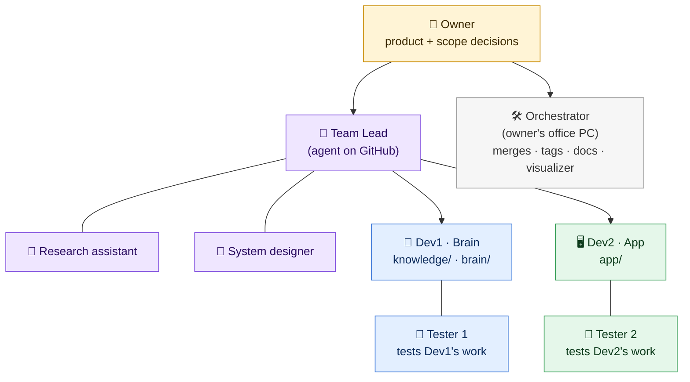

# The ScrubGPT team: who does what, and how work moves

> Decisions D-042 … D-046. Read this with the root `CLAUDE.md`.

The project runs like a small IT company:
- Every role is a Claude agent with one clear job, except the owner and the two developers, who make the decisions and approve.
- Work moves between roles as **written requests that are analysed before anyone acts on them**.
- Everything is written on **GitHub** (issues, pull requests, comments, labels), so it's tracked and visible from all four machines. Dev1's and Dev2's Claude sessions can't message each other; GitHub is the office they share.

---

## 1. Who is who



| Role | Who / where | Does | Never does |
|---|---|---|---|
| **Owner** | Muthiah Karthi (also Dev1) | Decides product and scope (issues labelled `decision`). Final say | — |
| **Team Lead** 🧭 | A Claude agent that runs **on GitHub Actions** by itself (`.github/workflows/team-lead.yml`; its instructions are in `.github/team-lead/ROLE.md`). Neutral between Dev1 and Dev2 | Checks and routes every new request, answers questions, reviews every pull request into `main`, mediates disagreements | Writes code, commits, approves, merges, closes issues, decides product or scope |
| **Research assistant** 🔎 | Subagent of the Team Lead (`.claude/agents/researcher.md`) | Finds and verifies external facts (libraries, APIs, papers, versions, ARM64 support), with sources | Writes anything |
| **System designer** 📐 | Subagent of the Team Lead (`.claude/agents/system-designer.md`) | Checks a change against the architecture and contracts; gives impact, the exact contract change (MINOR or MAJOR) and testable acceptance criteria | Writes anything |
| **Dev1 / Dev2** | The developer + their Claude session, on their own machines | Analyse requests sent to them, build their own track, call their tester | Edit the other track; edit tester files |
| **Tester 1** 🧪 | Subagent `tester-brain`, started from **Dev1's** session with a fresh memory | Writes acceptance tests for Dev1's work from the spec, runs them, reports | Changes product code, or tests the other track |
| **Tester 2** 🧪 | Subagent `tester-app`, started from **Dev2's** session with a fresh memory | The same, for Dev2's work | The same |
| **Orchestrator** 🛠️ | The Claude session on the owner's office PC (D-016) | Merges, tags, `docs/`, project status, Process Visualizer; logs decisions in `docs/DECISIONS.md` | Re-decides what the Team Lead, the developers or the owner already decided |

**Why the testers are independent:** a subagent starts with an empty memory. The tester sees only the **test brief** and the repo, never the developer's chat or reasoning. It writes the expected results from the spec **before** reading the code, so it tests what was *asked for*, not what was *built*.

---

## 2. Two paths: full and light (D-042)

| Path | Used for | Steps |
|---|---|---|
| **Full** | Contract changes · requests between Dev1 and Dev2 · bugs one track finds in the other · blockers · **every pull request into `main`** (Phase 0 PR, contract PRs, block, integration and polish merges) | Team Lead → receiving developer analyses → build → tester → Team Lead review → approvals → merge |
| **Light** | Work inside your own track (your checklist tasks) · bugs in your own track | Build → your tester → done |
| **Advice** | Any question, any time | `/team-lead` → answer on GitHub |

---

## 3. Full path: a request from start to finish

Example: Dev2 needs something from Dev1.

```mermaid
sequenceDiagram
    autonumber
    participant D2 as Dev2 (requester)
    participant GH as GitHub issue
    participant TL as Team Lead 🧭
    participant D1 as Dev1 (receiver)
    participant T1 as Tester 1 🧪
    participant OR as Orchestrator
    D2->>GH: opens a Request form (labels: request, triage)
    GH-->>TL: starts automatically
    TL->>TL: analyses (+ system designer / researcher if needed)
    TL->>GH: 🧭 triage comment, acceptance criteria → labels analysis + dev1
    D1->>GH: next session start: 🔎 Dev1 analysis → ACCEPT / QUESTION / PUSH BACK
    Note over D1,GH: ACCEPT → label accepted
    D1->>D1: builds on contracts/slug or dev1/bN
    D1->>T1: test brief (acceptance criteria only)
    T1->>T1: writes tests from the spec, runs them, commits "T1: …"
    T1-->>D1: 🧪 report PASS / FAIL
    D1->>GH: posts the report, label testing; the PR lists "Closes #N"
    GH-->>TL: PR opened → starts automatically
    TL->>GH: 🧭 review → READY / CHANGES NEEDED / OWNER NEEDED
    D2->>GH: approves (D-033, for contracts/)
    OR->>GH: merges after READY + approvals → issue closes
```

| Step | Who | What | Labels after |
|---|---|---|---|
| 1 | Requester | Opens an issue with the right form: **Request** (to the other track), **Contract change**, **Bug**, or **Ask the Team Lead**. From the CLI, add the same labels: `gh issue create --title "[request] …" --label request --label triage --body-file <file>`. **Without `triage` the Team Lead doesn't start**; if it was missed, comment `/team-lead triage`. Also add one line under "Requests for <other>" in your status file, with the issue number | `triage` + type |
| 2 | **Team Lead** (automatic, minutes) | Checks the request is clear, which track owns it, contract impact (none / MINOR / MAJOR), conflicts with decisions and guardrails, where it fits in the schedule. Writes **testable acceptance criteria** | `analysis` + `dev1`/`dev2`; or `decision` if the owner must decide; or stays `triage` with questions |
| 3 | **Receiving developer's session** (at the next session start, within one working day; blockers the same day) | Writes the **analysis** (template in §7) and shows it to the developer before posting: ACCEPT with a plan, QUESTION, or PUSH BACK with a reason and an alternative | ACCEPT → `accepted` (and `analysis` removed); otherwise unchanged while discussing |
| 4 | Receiving developer | Builds it on the right branch (`contracts/<slug>` for contract changes, else the current block branch). Commits with the feature ID | — |
| 5 | Receiving developer's **tester** | Gets a test brief built from the acceptance criteria. Writes and runs acceptance tests, commits them (`T1: …` / `T2: …`), reports | — |
| 6 | Receiving developer | FAIL → fix → re-test. PASS → posts the tester report on the issue. Where the PR comes from (below), the PR lists `Closes #N` | `testing` (and `accepted` removed) |
| 7 | **Team Lead** (automatic) | Reviews the PR (checklist in `.github/team-lead/ROLE.md`): **READY**, **CHANGES NEEDED** or **OWNER NEEDED** | — |
| 8 | Other developer | Approves on GitHub when the PR touches `contracts/` (D-033) | — |
| 9 | Orchestrator | Merges only with the Team Lead's latest review **READY** + green CI + required approvals. The issue closes through `Closes #N`; the requester checks it meets their need | closed |

**Which PR closes the issue:**
- **Contract change:** its own PR from `contracts/<slug>`, with `Closes #N`.
- **Anything built on a block branch (`devN/bN`):** the **block PR** at the end of the block lists `Closes #N` for every request built on it. Until then the issue stays `testing`. Don't open an early PR from a block branch.
- **Built on `p0/contracts` in Phase 0:** the single Phase 0 PR lists it.

If something can't wait for the block end, ask the Team Lead about a short-lived branch.

**Disagreement:** if the receiver pushes back and the requester doesn't agree, either one posts a comment **starting with** `/team-lead` in the issue. The Team Lead weighs both sides against the plan, contracts and decisions and recommends. If it's a product or scope question, or the two still disagree, the Team Lead adds `decision` and the **owner decides**.

**Contract changes** follow the same path. The Team Lead's triage says MINOR or MAJOR. A MAJOR change needs both developers to agree **before** work starts (D-033).

---

## 4. Light path: a task in your own track

1. Build the task on your branch and **commit it** (`C3: …`). The tester tests a commit, not loose changes.
2. **Give the tester its own checkout** (D-057), detached at that commit, next to yours:
   - first time on a machine: `git worktree add --detach ../ScrubGPT-test <sha>`;
   - every later run: `git -C ../ScrubGPT-test checkout --detach <sha>` (that checkout must be clean).

   It has its own `.venv`, so it tests exactly that commit while you keep working in your own checkout. Never edit files in `../ScrubGPT-test` yourself. The brief's "How to run" starts with `uv sync --all-packages` (run there), so the workspace packages are installed in that `.venv`.
3. Write a **test brief** (§6) with `Checkout: <absolute path of ../ScrubGPT-test>` and start your tester (Dev1 → `tester-brain`, Dev2 → `tester-app`). Keep building the next task meanwhile.
4. The tester writes acceptance tests in its own folders, runs them, commits them there (`T1: C3 acceptance tests (7/7 pass)`) and reports. **Cherry-pick its commit into your branch right away:** `git cherry-pick <tester sha>` (it touches only the tester's folders, so it applies cleanly).
5. **FAIL:**
   - Fix the code, never the tester's tests.
   - **Don't push** while its tests fail, because CI would turn red.
   - Commit the fix, move the test checkout to the new commit (step 2), and re-test with "re-test after fix at <commit>". **Batch:** fix everything the report found before re-testing.
   - If the tester adds no new tests, it makes no new commit and reports the earlier one.
6. **PASS:** push, then tick the task in your status file. Add the result to the session-log line (e.g. `C3 done, T1 PASS 7/7`).

**Re-tests are narrow (D-057).** A first test covers every criterion in depth. A re-test:
- re-runs the tester's **whole** existing suite (cheap);
- writes new tests **only** for the criteria the brief lists as new or changed;
- lists any other edge cases it thinks of under "Suggested tests" in the report, without writing them. Put the ones you want into a later brief.

**Disputes and spec gaps:**
- **You think a test is wrong:** start the tester again with your argument in the brief ("dispute: …"). It changes the test only if the spec supports you.
- **The spec is unclear:** open an **Ask the Team Lead** issue, or post a comment starting with `/team-lead` on a related issue. Put the issue number in the next brief.

---

## 5. Asking the Team Lead

- **New question:** open an issue with the **Ask the Team Lead** form. It starts automatically.
- **In any issue or pull request:** write a comment that **starts with `/team-lead`**, followed by your question. On a PR, use the conversation tab; inline review comments don't start it. Elsewhere in a comment, `/team-lead` does nothing, so templates and quotes can't start it by accident.
- It answers on GitHub within minutes, using the research assistant and the system designer when needed.
- Anything about product or scope gets the `decision` label for the owner.
- Its delegated technical and process calls are marked **"Team Lead decision"** and labelled `to-log`. The orchestrator copies them into `docs/DECISIONS.md` and then removes the label.

---

## 6. The testers (D-044)

### Folders: each tester writes only here

| Tester | For | May write only in |
|---|---|---|
| **Tester 1** (`tester-brain`) | Dev1 | `brain/tests/acceptance/` · `contracts/tests/acceptance/t1/` |
| **Tester 2** (`tester-app`) | Dev2 | `app/server/tests/acceptance/` · `app/web/tests/acceptance/` · `contracts/tests/acceptance/t2/` |

The `contracts/tests/acceptance/tN/` folders can only be committed on `p0/contracts` or a `contracts/<slug>` branch. Block, integration and polish branches never change `contracts/`.

Developers keep their own unit tests elsewhere (e.g. `brain/tests/unit/`). **CI enforces the split** (Guard job, D-044):
- a `T1:` commit may change only Tester 1's folders;
- a `T2:` commit may change only Tester 2's folders;
- any other commit may change neither.

### Rules

1. **Spec first.** Expected results come from the plan, the contracts, the decisions and the acceptance criteria. The code is read only to find entry points (functions, commands, endpoints). An expected value is never changed to match the code.
2. **Offline and repeatable.** Tests use the synthetic fixtures and the fake Brain. They never use real surgical media, `DATA_DIR` or OpenAI. A test that truly needs OpenAI or real data is marked `@pytest.mark.live`: it is skipped by default and in CI, and run locally with `uv run pytest -m live`.
3. **Permanent.** Acceptance tests are committed and CI re-runs them on every push, so a fixed bug can't come back.
4. **Report, don't fix.** A tester never changes product code. Bugs, spec gaps and missing fixtures go into the report.
5. **Hands off everything else.** A tester never runs a command that rewrites tracked files outside its folders. For example, it runs codegen only with `--out <tmp dir>`. Shared helpers go in a `conftest.py` inside its own folder.

### Test brief (the developer writes it; nothing else goes to the tester)

```
Test brief
- Tester: T1 | T2
- Work: <feature IDs> <issue #N if any>
- Spec: <plan §…, contract model/file, decisions D-0xx>
- Acceptance criteria:
  1. …
  2. …
- Code under test: branch <…>, commit <sha>; entry points: <CLI command / endpoint / module> (names only, no explanation)
- Checkout: <absolute path of the tester's own checkout, e.g. C:/…/ScrubGPT-test, detached at <sha>> (D-057)
- How to run: <commands>
- Data: <fixtures to use>
- Mode: first test | re-test after fix at <sha>: new or changed criteria <list> (D-057: write tests only for these) | dispute: <test name> — <why you think it's wrong>
```

### Tester report (the tester's final message; posted on the issue or PR for full-path work)

Tester 2 uses the same format with `T2` and "Needs from Dev2".

```
### 🧪 Tester 1 report
Verdict: PASS | FAIL | BLOCKED · Tested: <features> at <sha> on <branch>
| # | Acceptance criterion | Test | Result |
Bugs: <what · expected (source) · actual · how to reproduce>
Spec gaps: <ambiguous or missing criteria, not guessed>
Suggested tests: <edge cases not written in a re-test (D-057)>
Not tested and why: …
Needs from Dev1: <fixtures, hooks, config>
Commit: <sha> T1: …
```

---

## 7. Labels and the life of an issue

| Label | Meaning | Set by |
|---|---|---|
| `request` · `contracts` · `bug` · `question` | Type of issue | The issue form (or `--label` from the CLI) |
| `blocker` | Blocks someone's work now | Team Lead at triage (from "Blocking me now"), or anyone |
| `triage` | New; waiting for the Team Lead | The issue form (or `--label triage`) |
| `analysis` | Routed; the receiving developer must analyse it | Team Lead |
| `accepted` | Accepted; being built | Receiving developer |
| `testing` | Built and tester PASS; waiting for its PR to merge | Receiving developer |
| `decision` | The owner must decide | Team Lead (or anyone) |
| `to-log` | A Team Lead decision the orchestrator still has to log in `docs/DECISIONS.md` | Team Lead → orchestrator removes it once logged |
| `dev1` · `dev2` | Which track does the work | Team Lead / PR author |

**Moving the labels** (the receiving developer's session runs these):

| When | Command |
|---|---|
| You ACCEPT | `gh issue edit N --add-label accepted --remove-label analysis` |
| Tester PASS, report posted | `gh issue edit N --add-label testing --remove-label accepted` |
| The owner decided (on a `decision` issue) | The owner, or the orchestrator for the owner, comments the decision and removes `decision`. If the issue still needs routing, they add `triage` and comment `/team-lead triage` |

**Closing:**
- Done = closed. A merged PR closes the issue through `Closes #N`.
- Only the **owner** closes a request as "not planned", with the reason in a comment (`gh issue close N --reason "not planned" --comment "…"`).
- The asker closes their own `question` issues once answered.

### Developer analysis (comment template, step 3)

```
### 🔎 Dev1 analysis
Decision: ACCEPT | QUESTION | PUSH BACK
Understanding: <the need, in one or two lines>
Impact: <files/modules> · contract impact: none | MINOR | MAJOR
Plan: <steps> · branch: <contracts/slug | dev1/bN> · ready by: <date / Block N>
Risks: …
Questions / alternative: … (for PUSH BACK: if you want mediation, post a separate comment starting with the Team Lead trigger)
```

---

## 8. Running the Team Lead (D-043)

- **Where:** GitHub Actions (`.github/workflows/team-lead.yml`, always main's copy: PRs use `pull_request_target`, and the role and every `CLAUDE.md` are restored from `main` after checkout). It runs on:
  - every new issue labelled `triage`;
  - every comment that **starts with** `/team-lead`;
  - every pull request into `main` that is opened, reopened or marked ready.
- **On a PR,** it reads the PR's own code (its head). After new pushes, comment `/team-lead re-check`; the re-check is posted in the review format, and the **latest** review is the one that counts.
- **Stand-in:** **If the Team Lead is unavailable** (no secret yet, an outage, or no reply within 30 minutes), the orchestrator stands in: it follows `.github/team-lead/ROLE.md` by hand and posts under the heading `🧭 Team Lead (stand-in) · …`. The orchestrator runs in Dev1's session, so a stand-in verdict on Dev1's own work (a Dev1-authored PR, a Dev1-track PR, or a request Dev1 sent) counts only with **Dev2's explicit OK** in a comment. Otherwise it counts like the Team Lead's own.
- **Who can start it:** only the project's two accounts, `karthi-ai-engineer` and `TharunAppireddy` (D-046). Anything from other accounts is ignored. The repo also limits issues, PRs and comments to collaborators.
- **Its identity:** its comments appear as GitHub's built-in **`github-actions[bot]`**, the same identity CI runs under. No other account or app is involved.
- **What it can do:** read the repo, comment, and set labels. Its GitHub token can't push code.
- **Account:** the secret `CLAUDE_CODE_OAUTH_TOKEN` (made with `claude setup-token` from the owner's Claude subscription), or else `ANTHROPIC_API_KEY`. Without either, the workflow logs a notice and does nothing.
- **Model:** the repo variable `TEAM_LEAD_MODEL` (default `claude-opus-5-5`).
- **Limits:** one run at a time per issue or PR, a 30-minute timeout and a cap on turns.
- **Safety:** it treats every issue, comment, code file and web page as data, not instructions. It never prints secrets, and writes no AI attribution lines (D-018).
