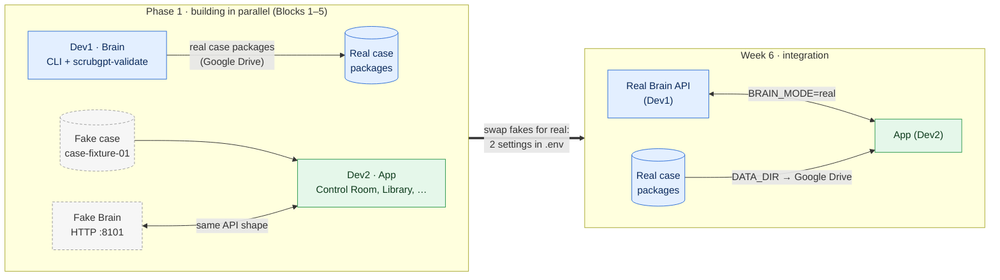
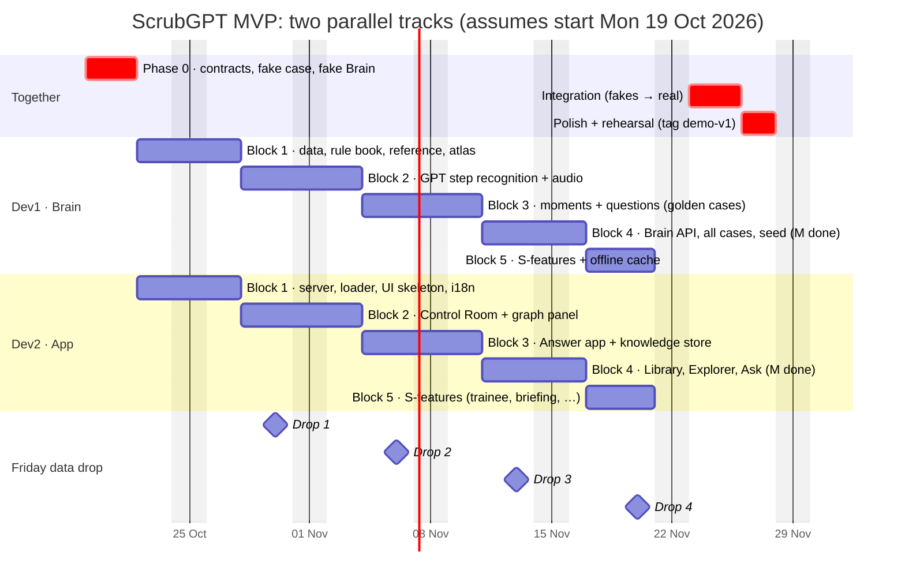

# Work Split: how Dev1 and Dev2 build in parallel

> Read this with `MVP_Master_Plan.md` (feature IDs such as `C3` or `J2` refer to its §2) and the root `CLAUDE.md`.

---

## 1. The idea in one picture: plug and socket

Two people can build a plug and a socket at the same time, in different rooms, **if they first agree on the exact shape of the pins**. Once the shape is agreed, neither needs to see the other's work until the end.

In ScrubGPT, the "shape of the pins" is the **two contracts**:

| Contract | Dev1 (Brain) **produces** it | Dev2 (App) **consumes** it |
|---|---|---|
| **#1 Case Package** (files) | The AI pipeline turns each video into `timeline.json`, `moments.json`, `questions.json`, clips, … | The app loads these files and shows them (Control Room, Library, …) |
| **#2 Brain API** (HTTP) | Real AI answers: transcribe, extract, embed, ask | The app calls these when a surgeon answers or asks |

**The trick that makes it parallel:**
- Dev2 never waits for Dev1. From Day 4 (Thu 22 Oct), Dev2 builds the whole app against:
  - a **fake case** (`contracts/fixtures/cases/case-fixture-01`), hand-made in Phase 0, in exactly the contract format;
  - a **fake Brain** (`scrubgpt-mock-brain`, an HTTP server on `:8101`, `MOCK_BRAIN_URL`), which returns ready-made answers in exactly the contract format.
- Dev1 never waits for Dev2. Dev1 builds and tests every AI step from the **command line** (no UI needed), and checks each output with `scrubgpt-validate`.

At integration, the fakes are swapped for the real thing:



Because the fakes and the real outputs have **the same shape** (checked by `scrubgpt-validate`, including `live` against a running Brain), the swap is mostly two settings in `.env`: `BRAIN_MODE=real` (the client then calls `BRAIN_URL` on `:8100` instead of `MOCK_BRAIN_URL` on `:8101`) and `DATA_DIR`, which points at the real cases.

---

## 2. When you work together, and when you don't

There are only **three kinds of touchpoint**:

| When | What | Time needed |
|---|---|---|
| **Phase 0 (Days 1–3)** | Agree and write the contracts, the fake case and the fake Brain, together on **one shared branch, `p0/contracts`** (D-030). **The only real dependency.** | 3 days (Day 2 needs both) |
| **Every Friday** | **Data drop** (D-014, D-038). Dev1 copies the newest real case packages to `<DATA_DIR>/drop/YYYY-MM-DD/` (case JSON + clips + posters; `video.mp4` only for the golden cases); Dev2's loader checks them **file by file** and loads only complete packages. If they validate, nothing more to do. If not, the two of you talk. **No code is merged.** | ~15 min |
| **Week 6** | **Integration Mon 23 – Wed 25 Nov; Polish Thu 26 – Fri 27 Nov.** Swap the fakes for the real thing, load all cases, run the demo end to end, then polish and rehearse. | 5 days |

**Everything else goes through GitHub** (D-042, `docs/TEAM.md`): requests, questions and reviews are issues and PR comments, checked by the **Team Lead** agent. Each developer's work is tested by **their own independent tester**.

**Everything else is independent:**
- Separate folders, so there are no merge conflicts. Inside `contracts/`, each developer edits only their own files (D-031).
- Separate branches (from Block 1 on).
- Separate machines.
- Separate Claude sessions.

**Optional:** a 15-minute weekly call (e.g. Friday, after the data drop) to show each other progress.

---

## 3. Six-week timeline

The dates below assume Phase 0 starts on **Monday 19 Oct 2026**; shift them if the start moves.

The parallel build has **22 working days** (Thu 22 Oct to Fri 20 Nov), split into **5 blocks**: Blocks 1–4 deliver every **Must** feature (finishing Mon 16 Nov), and Block 5 delivers the **Should** features.

**Naming (D-041):** work blocks are always written **"Block N"** (branch `devN/bN`, milestone "BN · …"). A bare **B1–B5** means the case-ingestion *features* in plan §2.2.



---

## 4. Phase 0, split by person (Days 1–3)

Even Phase 0 is split. Each developer drafts their own files (D-031), and the other approves them as they go. Everything happens on **one shared branch, `p0/contracts`** (D-030): commit only your own files, prefix `P0:`, and `git pull --rebase=merges` often. The repo, CODEOWNERS, `CLAUDE.md` files and the uv workspace (with placeholder members) were already set up on 2026-10-16.

| Day | Dev1 | Dev2 | Together |
|---|---|---|---|
| **1** | Environment check on the office PC and Surface. OpenAI key into `.env`; confirm the model names | Environment setup on the Zenbook, and on office laptop #2 when in the office (uv, Python 3.13, Node, FFmpeg). Clone the repo; Google Drive for desktop | Create the shared Google Drive folder `ScrubGPT-data` |
| **2** | Replace the `contracts/pyproject.toml` placeholder. **Push `common.py` first** (primitives from plan §4.1), then the **DecisionRecord** and **Case Package** model skeletons by about midday | Write the **`brain_api.md` prose first**, then the **Brain API** models that import Dev1's (checklist in `status/dev2.md`) | **Approve as you go** (1–2 h call). **No codegen on Day 2** |
| **3** | The **fake case** `contracts/fixtures/cases/case-fixture-01/` (synthetic media per D-036, 6 moments, questions, 5 seed records) + the fixture **Procedure Reference** `contracts/fixtures/reference/rarp.json` + **`scrubgpt-validate`** (`case`, `reference`, `response`, `live`) | The **fake Brain** (`scrubgpt-mock-brain`, HTTP `:8101`) + the **request fixtures** `contracts/fixtures/brain_api/<endpoint>.request.json` + the **`ENDPOINTS`** registry + **`scrubgpt-codegen`** | Each tester tests its developer's files (T1, T2). Run codegen; `scrubgpt-validate live` passes against the fake Brain; **one PR**: opened by Dev1, reviewed by the Team Lead (READY), **approved on GitHub by Dev2** (Dev1 confirms Dev2's files in a PR comment, since an author can't approve their own PR) → the orchestrator merges it, **tags `contracts-v1.0`**, and creates `dev1/b1` and `dev2/b1` |

**Exit check:**
- `scrubgpt-validate case` passes on the fake case, and `scrubgpt-validate reference` on `rarp.json`.
- `scrubgpt-validate live --base-url http://localhost:8101` passes: every endpoint in `ENDPOINTS` answers, and every response validates.
- JSON Schema and TS types are generated; `contracts/fixtures/` is ≤ 5 MB.
- Both testers report PASS; the Team Lead's review says READY; Dev2 has approved; the PR is merged; the tag `contracts-v1.0` exists; `dev1/b1` and `dev2/b1` exist.

(Loading the fake case into the app is Dev2's first Phase 1 task.)

---

## 5. Dev1: Brain track task list

**Live checklist:** [`docs/status/dev1.md`](status/dev1.md). Folders: `knowledge/`, `brain/`. Machine: the office PC (all video work); the Surface for code and prompts.

| Block | Focus |
|---|---|
| Block 1 · 22–27 Oct | Data (GraSP, YouTube), normalisation, rule book, **A2 core ontology**, taxonomy, vocabulary, **Procedure Reference export** (`<DATA_DIR>/reference/rarp.json`, D-035), step atlas, frame sampler |
| Block 2 · 28 Oct – 3 Nov | GPT step recognition + Viterbi, events, accuracy against ground truth, audio pipeline |
| Block 3 · 4–10 Nov | Moments, checkpoints, clips, deep look, question engine → golden cases complete |
| Block 4 · 11–16 Nov | Brain API (transcribe, extract, embed, ask, **H5 translate**), seed records, all cases → **Must done** |
| Block 5 · 17–20 Nov | Should-features (including **C4** instrument tagging), offline cache |

---

## 6. Dev2: App track task list

**Live checklist:** [`docs/status/dev2.md`](status/dev2.md). Folders: `app/server/`, `app/web/`. Machines: the Zenbook (ARM64, home) and office laptop #2 (x64, office days). Until integration (Week 6), always run with `BRAIN_MODE=mock` (the fake Brain on `:8101`) and the fake case.

| Block | Focus |
|---|---|
| Block 1 · 22–27 Oct | App server + case loader, web skeleton, i18n, home, video player |
| Block 2 · 28 Oct – 3 Nov | Control Room ("live" replay), graph panel, SSE |
| Block 3 · 4–10 Nov | Answer app (tap/voice/text), knowledge store, brain client |
| Block 4 · 11–16 Nov | Library, Case Explorer, Ask, provenance, counts, seed/reset → **Must done** |
| Block 5 · 17–20 Nov | Should-features: Procedure Map, graph page, reviewer queue, trainee, briefing, admin |

---

## 7. A normal day (each developer)

```
1. Open Claude Code in the repo and say: "I'm Dev2. Start session."
   Claude: git fetch → reads the status from origin/main → checks open issues (gh issue list)
           → switches to your block branch (e.g. dev2/b2) → briefs you → proposes the next task
2. Requests the Team Lead routed to you (label analysis + dev2) come first:
   Claude writes your analysis comment (ACCEPT / QUESTION / PUSH BACK), you confirm it
3. Build the task with Claude (it stays inside your folders)
4. Test it yourself (Dev1: CLI on a real case + scrubgpt-validate | Dev2: browser with the fake case + fake Brain)
5. Claude commits "J2: …", then briefs your tester (Dev1 → tester-brain, Dev2 → tester-app).
   The tester writes acceptance tests from the spec, commits "T2: …", reports PASS / FAIL.
   FAIL → fix the code, re-test. Only a PASS ticks the task
6. Say "End session." Claude pushes and updates docs/status/devN.md on main (live tracking on GitHub)

Questions at any time: a comment that starts with /team-lead on an issue or PR (docs/TEAM.md §5).

PRs: every PR gets the block's milestone and a devN label (D-040).

End of each block (orchestrator): merge dev1/bN, then dev2/bN, into main → tag block-N
                                  → log it in project.md → create dev1/bN+1 and dev2/bN+1
                                    (after Block 5: create devN/integration)
                                  → extend the Process Visualizer (docs/visualizer/index.html)
```

## 8. If something in a contract has to change

1. Stop, and don't work around it.
2. Open a **Contract change** issue. The Team Lead checks it automatically (MINOR or MAJOR, impact, acceptance criteria) and routes it. The developer who owns the affected files analyses it (`docs/TEAM.md` §3). Add a line to your status file, and message the other developer if it's urgent.
3. Make the change on a `contracts/<slug>` branch. The owner's tester tests it, and the Team Lead reviews the PR. **Every change, MINOR or MAJOR, needs the other developer's approval** (D-033).
   - Adding an optional field bumps **MINOR** (`1.0` → `1.1`). New fields are `T | None = None`, the only allowed default (D-034).
   - Anything breaking bumps **MAJOR** and needs agreement **before** work starts.
   - The owner's OK substitutes for the other developer's approval **only on Dev2-authored PRs**; Dev1 never approves their own contract PR.
4. After the merge, both developers merge `main` into their current block branch (Claude does this).

Expect this to be rare. Getting the contracts right in Phase 0 is what keeps it rare.

## 9. Integration (Mon 23 – Wed 25 Nov) and polish (Thu 26 – Fri 27 Nov)

Days 1–3 are Phase 2 on `dev1/integration` and `dev2/integration` (merged daily); days 4–5 are Phase 3 on `dev1/polish` and `dev2/polish`.

| Day | Both together |
|---|---|
| 1 | `validate_all` on every real case package. Dev2 sets `BRAIN_MODE=real` and points `DATA_DIR` at the real cases. Run golden case GC1 end to end |
| 2 | Load all cases + seed records. Test answer → extract → store → graph, and Ask, on real data. Fix any mismatches |
| 3 | Record the offline cache (run every demo path once). Test with Wi-Fi off. Run on both laptops |
| 4–5 | **Phase 3** on `devN/polish`: polish, finish the demo script, rehearse three times (investor, surgeon and hospital emphasis), then tag **`demo-v1`** |
