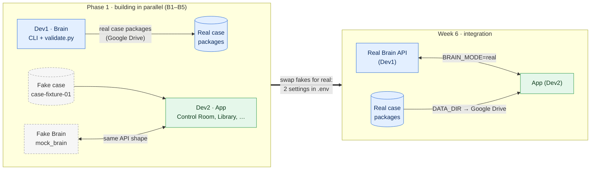
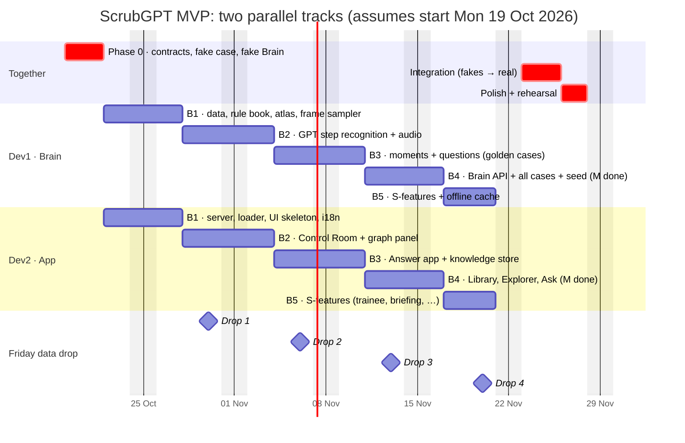

# Work Split: how Dev1 and Dev2 build in parallel

> Read this with `MVP_Master_Plan.md` (feature IDs such as `C3` or `J2` refer to its §2) and the root `CLAUDE.md`.

---

## 1. The idea in one picture: plug and socket

Two people can build a plug and a socket at the same time, in different rooms, **if they first agree on the exact shape of the pins**. Once the shape is agreed, neither needs to see the other's work until the end.

In ScrubGPT, the "shape of the pins" is the **two contracts**:

| Contract | Dev1 (Brain) **produces** it | Dev2 (App) **consumes** it |
|---|---|---|
| **#1 Case Package** (files) | The AI pipeline turns each video into `timeline.json`, `moments.json`, `questions.json`, clips, … | The app loads these files and shows them (Control Room, Library, …) |
| **#2 Brain API** (HTTP) | Real AI answers: transcribe, extract, embed, ask | The app calls these when a surgeon answers or asks |

**The trick that makes it parallel:**
- Dev2 never waits for Dev1. From Day 4 (Thu 22 Oct), Dev2 builds the whole app against:
  - a **fake case** (`contracts/fixtures/case-fixture-01`), hand-made in Phase 0, in exactly the contract format;
  - a **fake Brain** (`contracts/mock_brain`), which returns ready-made answers in exactly the contract format.
- Dev1 never waits for Dev2. Dev1 builds and tests every AI step from the **command line** (no UI needed), and checks each output with `validate.py`.

At integration, the fakes are swapped for the real thing:



Because the fakes and the real outputs have **the same shape** (checked by `validate.py`), the swap is mostly two settings in `.env`: `BRAIN_MODE=real` and `DATA_DIR`, which points at the real cases.

---

## 2. When you work together, and when you don't

There are only **three kinds of touchpoint**:

| When | What | Time needed |
|---|---|---|
| **Phase 0 (Days 1–3)** | Agree and write the contracts, the fake case and the fake Brain. **The only real dependency.** | 3 days (Day 2 needs both) |
| **Every Friday** | **Data drop.** Dev1 copies the newest real case packages to `<DATA_DIR>/drop/YYYY-MM-DD/`; Dev2 runs the loader on them. If they validate, nothing more to do. If not, the two of you talk. **No code is merged.** | ~15 min |
| **Week 6 (23–25 Nov)** | **Integration.** Swap the fakes for the real thing, load all cases, run the demo end to end. | 3 days |

**Everything else is independent:**
- Separate folders, so there are no merge conflicts.
- Separate branches.
- Separate machines.
- Separate Claude sessions.

**Optional:** a 15-minute weekly call (e.g. Friday, after the data drop) to show each other progress.

---

## 3. Six-week timeline

The dates below assume Phase 0 starts on **Monday 19 Oct 2026**; shift them if the start moves.

The parallel build has **22 working days** (Thu 22 Oct to Fri 20 Nov), split into **5 blocks**: B1–B4 deliver every **Must** feature (finishing Mon 16 Nov), and B5 delivers the **Should** features.



---

## 4. Phase 0, split by person (Days 1–3)

Even Phase 0 is split. Each developer drafts one half, and the other reviews it.

| Day | Dev1 | Dev2 | Together |
|---|---|---|---|
| **1** | Environment check on the office PC and Surface. OpenAI key into `.env`; confirm the model names | Environment setup on the Zenbook (uv, Python 3.13, Node, FFmpeg). Clone the repo; Google Drive for desktop | Create the shared Google Drive folder `ScrubGPT-data` |
| **2** | First the uv workspace (on `main`). Then `common.py` (primitives from plan §4.1), the **Case Package** models and **DecisionRecord** on `p0/dev1-case-package` | The **Brain API** models (importing `common.py`) + `brain_api.md` on `p0/dev2-brain-api` (checklist in `status/dev2.md`) | **Approve each other's PRs** (1–2 h call). Then generate the JSON Schema and TS types |
| **3** | The **fake case** `contracts/fixtures/cases/case-fixture-01/` (synthetic video, 6 moments, questions, 5 seed records) + **`validate.py`** | The **fake Brain** (`mock_brain`, HTTP `:8101`) + **codegen** | Everything passes `validate.py` → **tag `contracts-v1.0`** |

**Exit check:**
- `validate.py` passes on the fake case.
- Every fake-Brain response passes `validate.py`.
- The TS types are generated.
- The tag exists.

(Loading the fake case into the app is Dev2's first Phase 1 task.)

---

## 5. Dev1: Brain track task list

**Live checklist:** [`docs/status/dev1.md`](status/dev1.md). Folders: `knowledge/`, `brain/`. Machine: the office PC (all video work); the Surface for code and prompts.

| Block | Focus |
|---|---|
| B1 · 22–27 Oct | Data (GraSP, YouTube), normalisation, rule book, taxonomy, vocabulary, step atlas, frame sampler |
| B2 · 28 Oct – 3 Nov | GPT step recognition + Viterbi, events, accuracy against ground truth, audio pipeline |
| B3 · 4–10 Nov | Moments, checkpoints, clips, deep look, question engine → golden cases complete |
| B4 · 11–16 Nov | Brain API (transcribe, extract, embed, ask), seed records, all cases → **Must done** |
| B5 · 17–20 Nov | Should-features, offline cache |

---

## 6. Dev2: App track task list

**Live checklist:** [`docs/status/dev2.md`](status/dev2.md). Folders: `app/server/`, `app/web/`. Machine: the Zenbook. Until integration (Week 6), always run with `BRAIN_MODE=mock` and the fake case.

| Block | Focus |
|---|---|
| B1 · 22–27 Oct | App server + case loader, web skeleton, i18n, home, video player |
| B2 · 28 Oct – 3 Nov | Control Room ("live" replay), graph panel, SSE |
| B3 · 4–10 Nov | Answer app (tap/voice/text), knowledge store, brain client |
| B4 · 11–16 Nov | Library, Case Explorer, Ask, provenance, counts, seed/reset → **Must done** |
| B5 · 17–20 Nov | Should-features: Procedure Map, graph page, reviewer queue, trainee, briefing, admin |

---

## 7. A normal day (each developer)

```
1. Open Claude Code in the repo and say: "I'm Dev2. Start session."
   Claude: git fetch → reads the status from origin/main → switches to your block branch (e.g. dev2/b2)
           → briefs you → proposes the next task
2. Build the task with Claude (it stays inside your folders)
3. Test (Dev1: CLI on a real case + validate.py | Dev2: browser with the fake case + fake Brain)
4. Claude commits "J2: …" on your block branch and pushes (no AI attribution)
5. Say "End session." Claude updates docs/status/devN.md on main (live tracking on GitHub)

End of each block (orchestrator): merge dev1/bN, then dev2/bN, into main → tag block-N
                                  → log it in project.md → create dev1/bN+1 and dev2/bN+1
                                  → extend the Process Visualizer (docs/visualizer/index.html)
```

## 8. If something in a contract has to change

1. Stop, and don't work around it.
2. Write the request in your status file and message the other developer.
3. Make the change on a `contracts/<slug>` branch. **The other developer approves it.**
   - Adding an optional field bumps **MINOR** (`1.0` → `1.1`).
   - Anything breaking bumps **MAJOR** and needs agreement first.
4. After the merge, both developers merge `main` into their current block branch (Claude does this).

Expect this to be rare. Getting the contracts right in Phase 0 is what keeps it rare.

## 9. Integration week (Week 6: Mon 23 – Fri 27 Nov)

| Day | Both together |
|---|---|
| 1 | `validate_all` on every real case package. Dev2 sets `BRAIN_MODE=real` and points `DATA_DIR` at the real cases. Run golden case GC1 end to end |
| 2 | Load all cases + seed records. Test answer → extract → store → graph, and Ask, on real data. Fix any mismatches |
| 3 | Record the offline cache (run every demo path once). Test with Wi-Fi off. Run on both laptops |
| 4–5 | Polish, finish the demo script, rehearse three times (investor, surgeon and hospital emphasis), apply the freeze tag |
